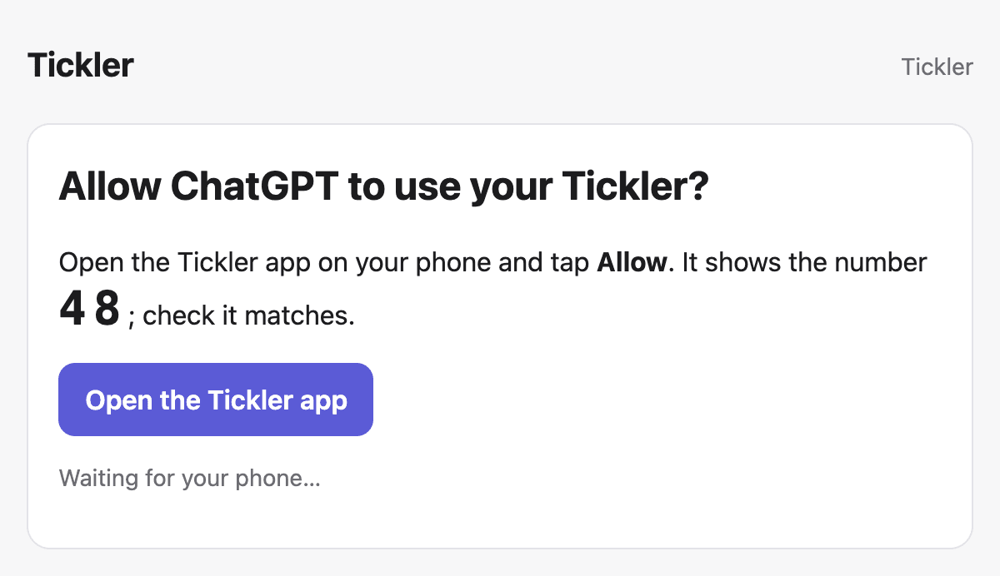

# Connect ChatGPT

Add Tickler to ChatGPT as a custom connector in developer mode, so it can add entries. About 5 minutes.

## Turn on developer mode

In ChatGPT on the web, open **Settings**, then **Apps** (or **Connectors**), then **Advanced settings**, and turn on **Developer mode**. In a workspace, an admin may need to allow it first.

## Add Tickler

1. In **Settings**, then **Apps**, press **Create** (or **Add custom MCP server**).
2. Name it `Tickler` and paste this URL.
3. Choose **OAuth**, accept the notice, and press **Create**.

```
{{SERVER_URL}}/mcp
```

## Allow it on your phone

ChatGPT opens a page from your own server with a two-digit number. In the Tickler app, check it matches and tap **Allow**.



## Use it in a chat

Start a chat, choose **Developer mode** or pick Tickler from the tools menu, and ask this. ChatGPT asks you to confirm each write.

```
Use Tickler to add an entry for next Tuesday at 11:00: follow up with the designer about the icon, project App.
```


## Troubleshooting

- **Needs a public address:** on Docker, set up [Cloudflare Tunnel](../public-url-cloudflare-tunnel.md) or [Tailscale Funnel](../public-url-tailscale-funnel.md) first.
- **No developer mode or no write access:** your plan must allow custom connectors that can write. Business, Enterprise and Edu workspaces have it when an admin turns it on. Menus change often, so check ChatGPT's help pages.
- **No phone handy:** sign in on that page with your passkey or passphrase instead.
- **Add entries without asking:** paste the [instruction block](../instruction-block.md) into a Project's instructions or **Customize ChatGPT**.
- **Revoke access:** in setup, under **OAuth apps**, press **Revoke**.
- **Finding the chat later:** entries show the chat's topic, and **Open ChatGPT** copies it for search.
