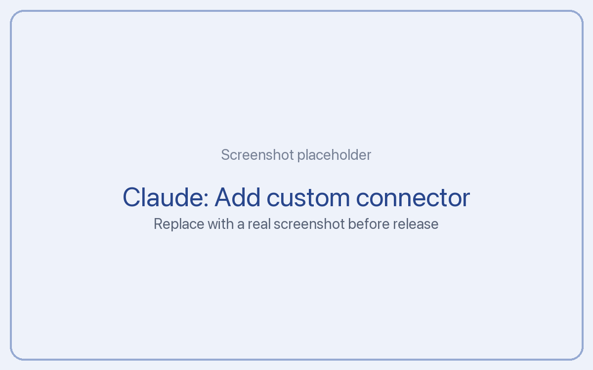

# Connect the Claude apps

Add Tickler as a **custom connector** in Claude on the web, desktop or mobile. Claude connects from the cloud, so your server needs a public HTTPS address. On Cloudflare you have one already. On Docker, set up [Cloudflare Tunnel](../public-url-cloudflare-tunnel.md) or [Tailscale Funnel](../public-url-tailscale-funnel.md) first.

**Time:** about 3 minutes.

**Plans:** custom connectors work on Pro, Max, Team and Enterprise. The Free plan allows one custom connector. On Team and Enterprise, an owner adds the connector for the organization first.

## Step 1: Add the connector

1. Open Claude on the web (claude.ai) or the desktop app.
2. Go to **Customize**, then **Connectors**.
3. Press **+** (Add), then **Add custom connector**.
4. Name: `Tickler`
5. Remote MCP server URL:

```
{{SERVER_URL}}/mcp
```

6. Leave the advanced OAuth settings empty. Your server registers Claude automatically.
7. Press **Add**.



## Step 2: Sign in to your own server

Press **Connect** next to Tickler. A page from **your own server** opens and asks you to log in with your passkey or passphrase, then to allow Claude access. Press **Allow**.

Claude never sees your passphrase. Your server gives Claude its own key, which you can revoke any time in setup under **AI tools**, then **Connected apps**.

## Step 3: Turn it on in a chat

In a chat, open the tools menu (the **+** or sliders button) and make sure **Tickler** is on. Then try:

```
Add a Tickler entry for Friday at 15:00 in project Website: send the launch checklist to Sam.
```

## Step 4 (optional): Add the instruction block

To have Claude add entries without being asked, paste the [instruction block](../instruction-block.md) into a Project's instructions, or into your personal preferences in Settings.

## Origins from the Claude apps

Claude's apps don't tell connectors which chat a request came from. So entries made from the Claude apps show the chat's topic as their origin title, and the app offers **Open Claude** with that title copied, so you can paste it into Claude's search.

## Troubleshooting

- **"Couldn't connect" when adding:** the address must be public HTTPS and end in `/mcp`. Check `{{SERVER_URL}}/api/health` loads from your phone's mobile data (not your Wi-Fi).
- **The login page doesn't open:** allow pop-ups for claude.ai, then press Connect again.
- **It worked, then stopped:** the access may have been revoked in setup. Remove the connector and add it again.
