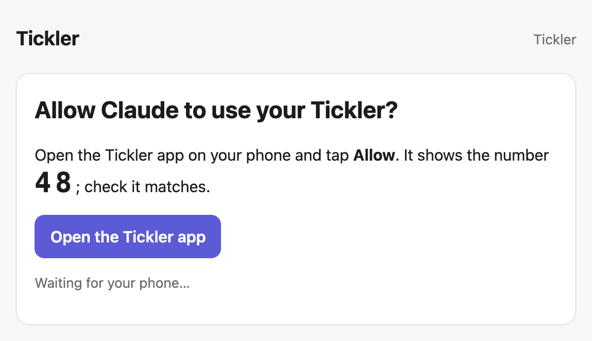
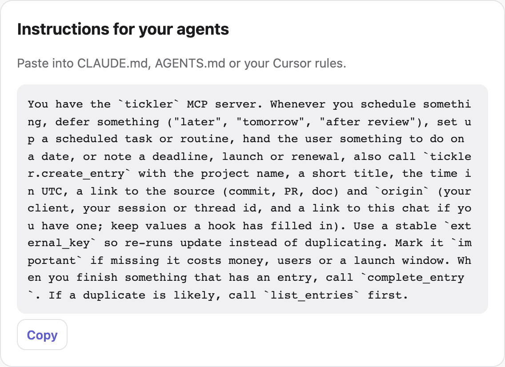

# Connect the Claude apps

Add Tickler as a custom connector in Claude on the web, desktop or phone. About 3 minutes.

## Add the connector

1. In Claude on the web or desktop, go to **Customize**, then **Connectors**.
2. Press **+**, then **Add custom connector**.
3. Name it `Tickler`, paste this URL, leave the OAuth settings empty, and press **Add**.

```
{{SERVER_URL}}/mcp
```

## Allow it on your phone

Press **Connect** next to Tickler. A page from your own server shows a two-digit number. In the Tickler app, check the number matches and tap **Allow**.



## Turn it on in a chat

In a chat, open the tools menu (the **+** or sliders button), make sure **Tickler** is on, and try:

```
Add a Tickler entry for Friday at 15:00 in project Website: send the launch checklist to Sam.
```


## Add the instruction block

To have Claude add entries without being asked, paste the [instruction block](../instruction-block.md) into a Project's instructions, or into your personal preferences in Settings.



## Troubleshooting

- **Needs a public address:** Claude connects from the cloud. On Docker, set up [Cloudflare Tunnel](../public-url-cloudflare-tunnel.md) or [Tailscale Funnel](../public-url-tailscale-funnel.md) first.
- **Plans:** custom connectors work on Pro, Max, Team and Enterprise. Free allows one. On Team and Enterprise, an owner adds it first.
- **"Couldn't connect":** the address must be public HTTPS and end in `/mcp`. Check `{{SERVER_URL}}/api/health` loads on your phone's mobile data.
- **The login page doesn't open:** allow pop-ups for claude.ai, then press **Connect** again.
- **No phone handy:** sign in on that page with your passkey or passphrase instead.
- **It stopped working:** access may have been revoked in setup. Remove the connector and add it again.
- **Finding the chat later:** entries show the chat's topic, and **Open Claude** copies it for Claude's search.
