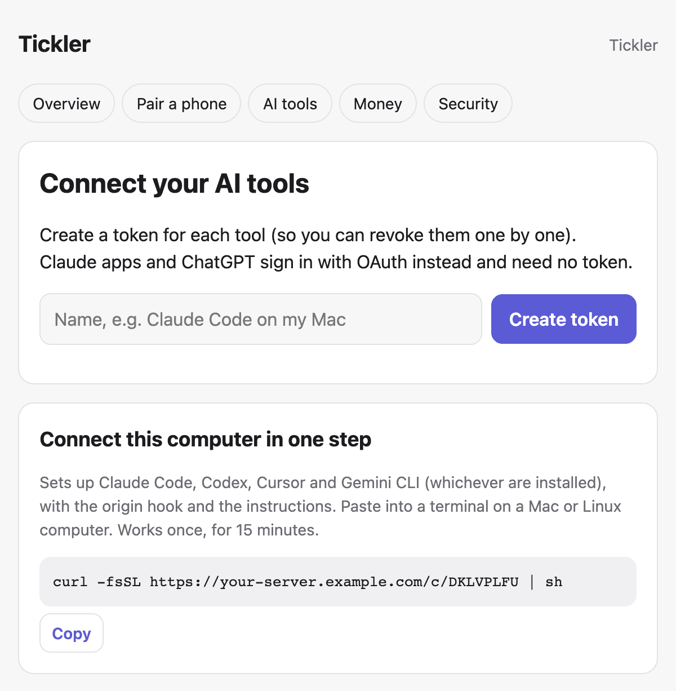
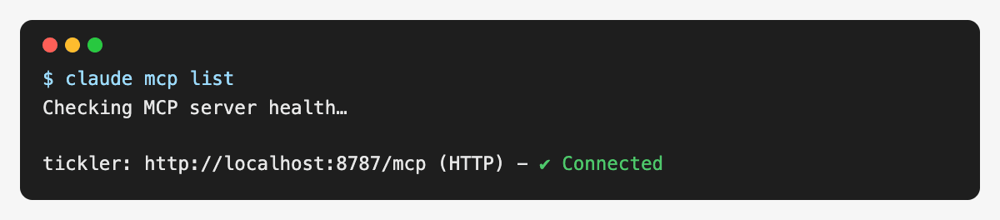

# Connect Claude Code

Let Claude Code add Tickler entries that link back to the session that made them. About 3 minutes.

## Add the Tickler server

Run this in a terminal. The token is a key just for this computer; the app fills it in.

```
claude mcp add --transport http --scope user tickler {{SERVER_URL}}/mcp --header "Authorization: Bearer {{MCP_TOKEN}}"
```

**Faster:** paste the one-line command from **AI tools** instead. It does every step here.



## Check it's connected

Run `claude mcp list`. You should see `tickler` with **Connected** next to it.



## Download the origin hook

The hook links each entry to its exact session, with a resume command you can copy from your phone. It needs Node.js 20 or newer.

```
mkdir -p ~/.claude/hooks
curl -fsSL https://raw.githubusercontent.com/arpitj007/tickler-server/main/hooks/claude-code/tickler-origin.mjs -o ~/.claude/hooks/tickler-origin.mjs
```

## Turn on the hook

Add this to `~/.claude/settings.json` (create it if needed; if it has `"hooks"`, add just the `PreToolUse` item). Then restart Claude Code.

```json
{
  "hooks": {
    "PreToolUse": [
      {
        "matcher": "mcp__tickler__.*",
        "hooks": [
          { "type": "command", "command": "node ~/.claude/hooks/tickler-origin.mjs" }
        ]
      }
    ]
  }
}
```

## Tell Claude when to use Tickler

Add the [instruction block](../instruction-block.md) to `~/.claude/CLAUDE.md`. Without it, Claude only uses Tickler when you ask.


## Try it

Ask Claude Code this. The entry appears in the app, and its origin card offers **Copy resume command**.

```
Remind me tomorrow at 10:00 to check the review comments on this branch.
```


## Troubleshooting

- **No token:** make one in setup under **AI tools**. Name it after the computer, like "Claude Code on MacBook".
- **"Failed to connect":** open `{{SERVER_URL}}/api/health` in a browser. If it doesn't load, this computer can't reach your server.
- **"Unauthorized":** the token was revoked or mistyped. Run `claude mcp remove tickler --scope user`, then add it again.
- **Entries show "unknown origin":** the hook isn't running. Check the path in `settings.json` and that `node --version` works.
- **What the hook reads:** your folder, git remote, branch and computer name. It sends them only to Tickler.
- **Claude Code on the web:** add this to the repo's `.mcp.json`, set `TICKLER_TOKEN` in your cloud environment, and commit the hook to `.claude/settings.json`.

```json
{
  "mcpServers": {
    "tickler": {
      "type": "http",
      "url": "{{SERVER_URL}}/mcp",
      "headers": { "Authorization": "Bearer ${TICKLER_TOKEN}" }
    }
  }
}
```
