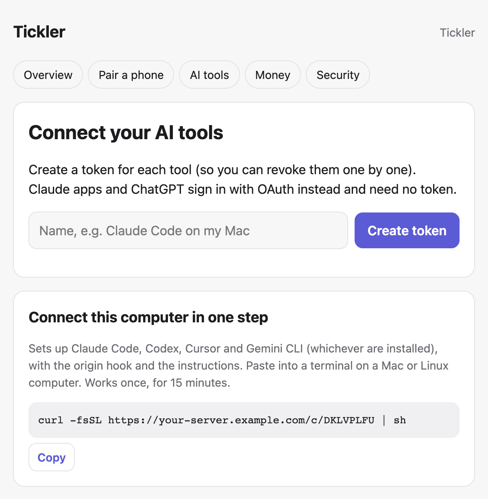
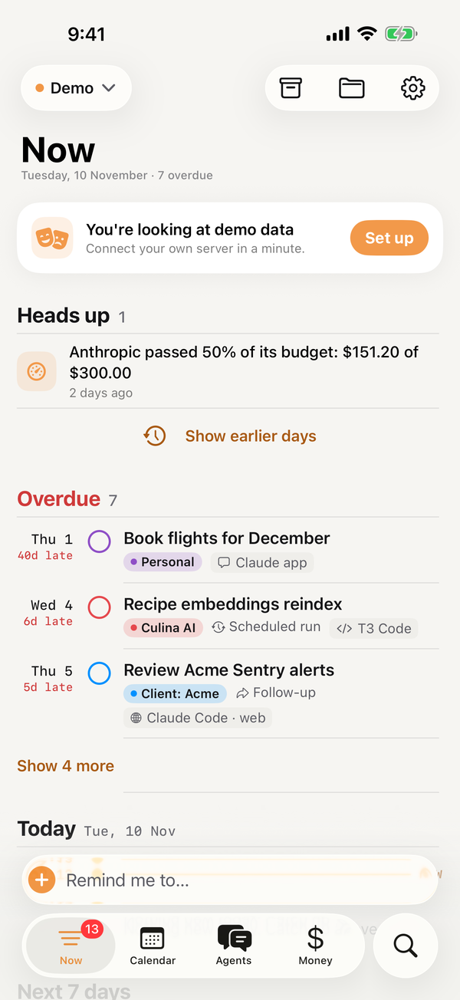

# Connect Codex

Let the Codex CLI and IDE extension add Tickler entries for you. About 2 minutes.

## Add Tickler to your Codex config

Add this to `~/.codex/config.toml` (create it if needed). The token is a key just for Codex; the app fills it in.

```toml
[mcp_servers.tickler]
url = "{{SERVER_URL}}/mcp"
http_headers = { "Authorization" = "Bearer {{MCP_TOKEN}}" }
```

**Faster:** paste the one-line command from **AI tools** instead. It sets up Codex and its instructions.



## Check it's connected

Run `codex mcp list`. Tickler should be listed. In a Codex session, `/mcp` shows its tools.

## Tell Codex when to use it

Add the [instruction block](../instruction-block.md) to `~/.codex/AGENTS.md` for every project, or to `AGENTS.md` in one project.


## Try it

Run this, then look for the entry in the app.

```
codex "Add a Tickler entry for the 1st of next month at 09:00: renew the staging certificate, project Infra, important."
```



## Troubleshooting

- **No token:** make one in setup under **AI tools**.
- **Keep the token out of the file:** use `bearer_token_env_var = "TICKLER_TOKEN"` instead of `http_headers`, add `export TICKLER_TOKEN="{{MCP_TOKEN}}"` to `~/.zshrc` or `~/.bashrc`, and open a new terminal.
- **Sign in with OAuth instead:** leave out the token line and run `codex mcp login tickler`. Tap **Allow** in the Tickler app.
- **Resume a session:** copy the session id from the entry's origin card and run `codex resume` with it.
