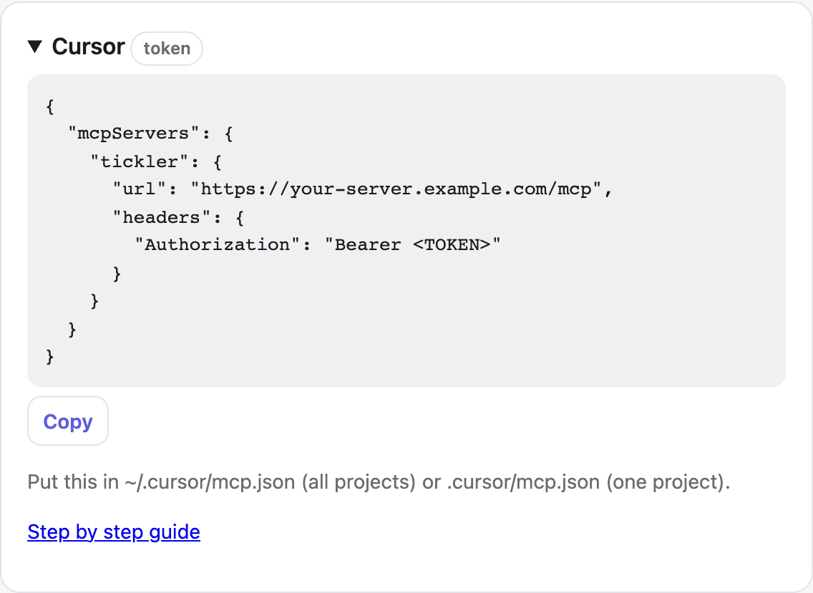

# Connect Cursor

Let Cursor's agent add Tickler entries for you. About 2 minutes.

## Add Tickler to Cursor

Paste this into `~/.cursor/mcp.json` (or **Settings**, **MCP**, **Add new global MCP server**). If it has `"mcpServers"`, add just the `"tickler"` part. The app fills in the token.

```json
{
  "mcpServers": {
    "tickler": {
      "url": "{{SERVER_URL}}/mcp",
      "headers": {
        "Authorization": "Bearer {{MCP_TOKEN}}"
      }
    }
  }
}
```



## Check it's connected

In Cursor, open **Settings**, then **MCP**. Tickler should show a green dot and its tools. If it's red, press refresh.

## Tell Cursor when to use it

Add the [instruction block](../instruction-block.md) under **Settings**, then **Rules**, then **User Rules**.


## Try it

In Cursor's chat, in Agent mode, ask this. Approve the tool call if Cursor asks.

```
Add a Tickler entry: re-run the migration check next Monday at 09:00, project Backend.
```


## Troubleshooting

- **Faster setup:** paste the one-line command from **AI tools** into a terminal. It sets up Cursor for you.
- **No token:** make one in setup under **AI tools**.
- **Keep the token out of the file:** use `"Bearer ${env:TICKLER_TOKEN}"` and set `TICKLER_TOKEN` in your shell profile.
- **One project only:** use `.cursor/mcp.json` inside the project. Don't commit a file that contains the token.
- **Origins:** Cursor sends no session id, so entries show Cursor's icon and a short title.
