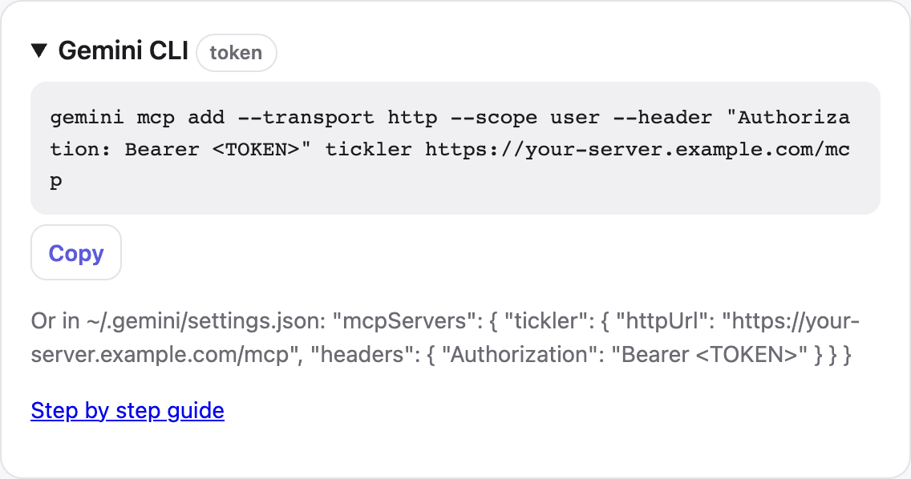

# Connect Gemini CLI

Let Gemini CLI add Tickler entries for you. About 2 minutes.

## Add the Tickler server

Run this in a terminal. The token is a key just for Gemini CLI; the app fills it in.

```
gemini mcp add --transport http --scope user --header "Authorization: Bearer {{MCP_TOKEN}}" tickler {{SERVER_URL}}/mcp
```



## Check it's connected

Start `gemini` and type `/mcp`. Tickler should be listed as connected, with its tools.

## Tell Gemini when to use it

Add the [instruction block](../instruction-block.md) to `~/.gemini/GEMINI.md`.


## Try it

Ask Gemini this, then look for the entry in the app.

```
Add a Tickler entry for tomorrow at 16:00: check the nightly build, project CI.
```


## Troubleshooting

- **Faster setup:** paste the one-line command from **AI tools** into a terminal. It sets up Gemini CLI and its instructions.
- **No token:** make one in setup under **AI tools**.
- **Prefer the settings file:** in `~/.gemini/settings.json`, add `"tickler": { "httpUrl": "{{SERVER_URL}}/mcp", "headers": { "Authorization": "Bearer {{MCP_TOKEN}}" } }` inside `"mcpServers"`. Use `httpUrl`, not `url`.
