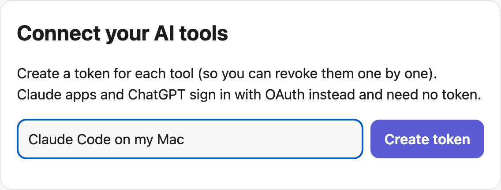
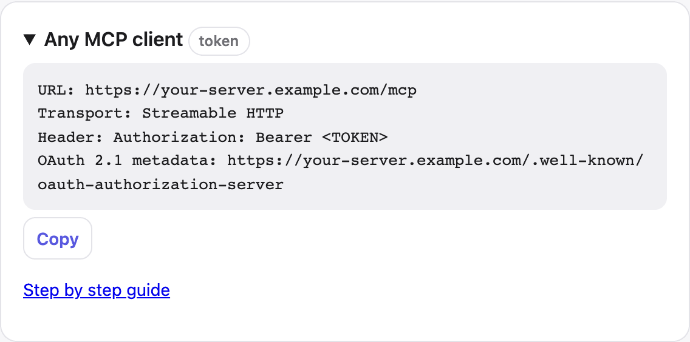

# Any other MCP client

Connect any tool that speaks MCP to Tickler with a URL and a token. About 5 minutes.

## Make a token

In setup, open **AI tools**, type a name for the tool and press **Create token**. Copy it; it's shown once. Use one token per tool.



## Add Tickler to your client

Use URL `{{SERVER_URL}}/mcp`, Streamable HTTP, and the header `Authorization: Bearer {{MCP_TOKEN}}`. Many clients take a file like this; some call the fields `serverUrl`, `httpUrl` or `streamable-http`.

```json
{
  "mcpServers": {
    "tickler": {
      "type": "http",
      "url": "{{SERVER_URL}}/mcp",
      "headers": { "Authorization": "Bearer {{MCP_TOKEN}}" }
    }
  }
}
```



## Check it

This should return a list of Tickler's tools:

```
curl -s {{SERVER_URL}}/mcp \
  -H "Authorization: Bearer {{MCP_TOKEN}}" \
  -H "Content-Type: application/json" \
  -H "Accept: application/json, text/event-stream" \
  -d '{"jsonrpc":"2.0","id":1,"method":"tools/list"}'
```

## Tell it when to use Tickler

Paste the [instruction block](../instruction-block.md) wherever your client keeps its system prompt or rules.


## Troubleshooting

- **OAuth instead of a token:** Tickler supports OAuth 2.1 with PKCE and dynamic client registration, discovered from the URL.
- **Client only runs local (stdio) servers:** use the `mcp-remote` bridge. It needs Node.js.

```json
{
  "mcpServers": {
    "tickler": {
      "command": "npx",
      "args": [
        "-y", "mcp-remote", "{{SERVER_URL}}/mcp",
        "--header", "Authorization: Bearer {{MCP_TOKEN}}"
      ]
    }
  }
}
```

- **Entries say "unknown origin":** have your agent send an `origin` object with each write, so entries link back:

```json
{
  "client": "other",
  "session_id": "your-tool-session-id",
  "title": "Short description of the conversation",
  "open_url": "a link that reopens it, if there is one"
}
```
