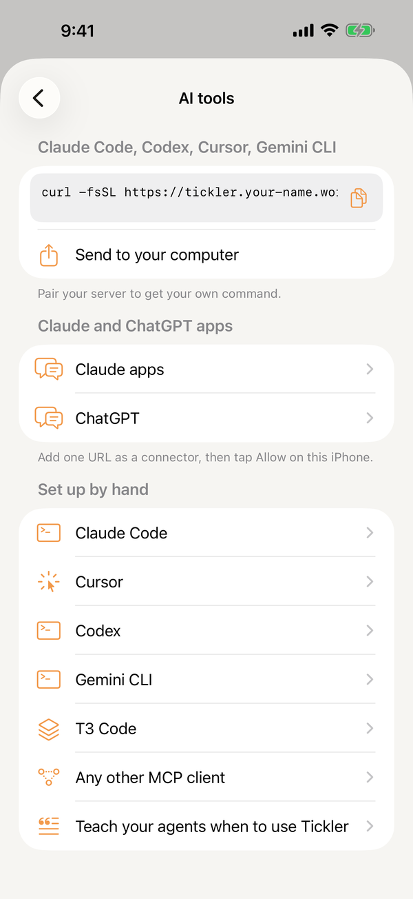

# T3 Code and other orchestrators

Make entries from T3 Code, and similar tools that run agents in threads, link back to the right thread. About 5 minutes.

## Connect the agents it runs

T3 Code uses each agent's own MCP settings. Connect Tickler to each agent you run through it, then restart the orchestrator:

- [Claude Code](claude-code.md)
- [Codex](codex.md)
- [Cursor](cursor.md)



## Link entries to threads

Add this line under the [instruction block](../instruction-block.md) in the agent's instructions file. Then **Open chat** on an entry opens the T3 thread.

```
When you run inside T3 Code, set origin.client to "t3_code", origin.session_id to the T3 thread id and origin.open_url to "t3-thread://v1/" followed by the thread id.
```

## Open a thread from an entry

In the app, open an entry an agent made inside T3 Code and tap **Open chat**. The thread opens in T3 Code on your computer.


## Troubleshooting

- **Scheduled runs:** set `origin.client` to `scheduled_task`, `origin.session_id` to the task id and `origin.parent_session_id` to the thread that set it up. The app then shows the run and the chat that scheduled it.
- **Subagents:** pass the parent's session id as `origin.parent_session_id`. The origin card then has **Show parent**.
