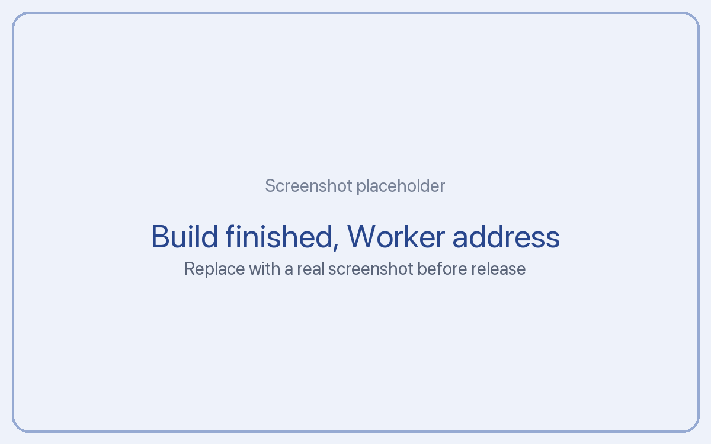

# Deploy on Cloudflare

This is the recommended way to run your Tickler server. It runs in your own Cloudflare account, on the free plan, and there is no machine for you to look after. You get a public HTTPS address right away, so every AI tool and every store webhook can reach it.

**Time:** about 5 minutes, most of it waiting for the first build.

**You need:** a free Cloudflare account and a free GitHub (or GitLab) account. You can create both during the steps below.

## What you will end up with

- A Cloudflare Worker called `tickler` with an address like `https://tickler.your-name.workers.dev`
- A D1 database (Cloudflare's hosted SQLite) that holds your entries, only in your account
- A copy of the Tickler server code in your own GitHub account, so you control updates

Nobody else, including the people who make Tickler, can see any of it.

## Step 1: Press the Deploy button

Open this link on a computer (a phone works too, but the screens are small):

[Deploy to Cloudflare](https://deploy.workers.cloudflare.com/?url=https://github.com/arpitj007/tickler-server)


Log in to Cloudflare, or create a free account if you don't have one.

## Step 2: Connect GitHub and name things

1. When asked, connect your GitHub or GitLab account. Cloudflare makes a copy of the Tickler code there. This is how you get updates later.
2. Keep the suggested names (`tickler` for the Worker and `tickler-db` for the database) unless you want different ones.
3. You will be asked for one secret, `TICKLER_SECRET`. It encrypts the provider keys you may add later. Paste a long random value. Any password manager can make one, or run this in a terminal:

```
openssl rand -base64 32
```

Keep a copy of it in your password manager. If you ever lose it, Tickler keeps working, but you will need to paste your provider keys again.

## Step 3: Create and deploy

Press **Create and deploy**. Cloudflare builds the server and creates the database. The first build takes 2 to 3 minutes.



When it finishes, you see your Worker's address. It looks like this:

```
https://tickler.your-name.workers.dev
```

## Step 4: Open the setup page

Add `/setup` to the address and open it in your browser:

```
https://tickler.your-name.workers.dev/setup
```

The first time, the setup page asks you to protect your server:

1. Create a **passkey** (recommended: it uses Face ID, Touch ID or your device PIN), or set a long **passphrase**.
2. Give your server a name, like "Personal". The app shows this name.

That's it. Your server is running.

## Next

- [Pair your phone](pair.md)
- [Connect your AI tools](connect/claude-code.md)

## Updating later

Your copy of the code lives in your GitHub account. To update:

1. Open your copy on GitHub.
2. Press **Sync fork** (or merge the latest changes from `arpitj007/tickler-server`).
3. Cloudflare rebuilds and deploys automatically. Your data stays where it is.

## If something goes wrong

- **The build failed:** open the Worker in the Cloudflare dashboard, then **Deployments**, and read the build log. Press **Retry build** once; most first-time failures are a temporary GitHub connection issue.
- **The setup page says "not found":** check that you added `/setup` and that the build finished.
- **You forgot your passphrase:** see "Locked out of setup" in the troubleshooting guide on the docs site.
