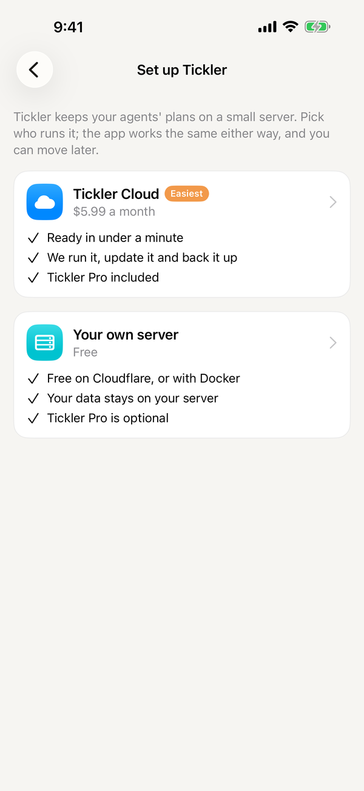
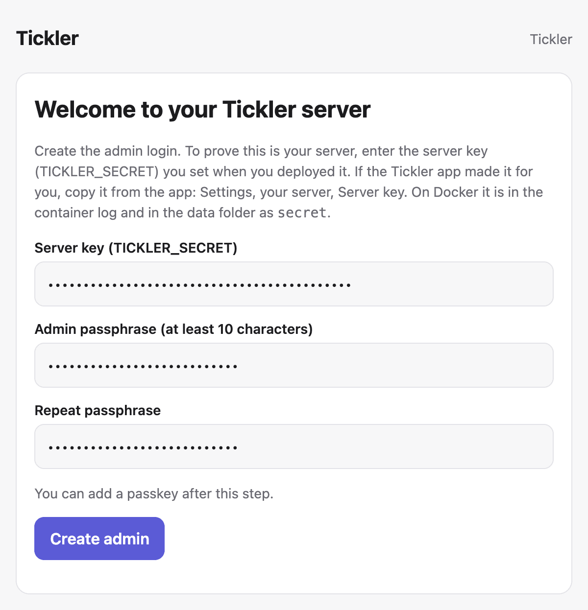

# Deploy on Cloudflare

Get your own Tickler server on Cloudflare's free plan, with a public HTTPS address, in about 5 minutes.

## Start in the app

1. In the Tickler app, tap **Get started**, then **Deploy to Cloudflare**.
2. The app makes your server key, copies it, and opens Cloudflare.

No app? Open [Deploy to Cloudflare](https://deploy.workers.cloudflare.com/?url=https://github.com/arpitj007/tickler-server) on a computer and make a key with `openssl rand -base64 32`.



## Fill in the Cloudflare form

1. Log in to Cloudflare, or create a free account.
2. Connect GitHub or GitLab. Cloudflare copies the Tickler code there, so you get updates.
3. Keep the suggested names, `tickler` and `tickler-db`.
4. Paste your server key into `TICKLER_SECRET`. Save a copy in your password manager.

## Create and deploy

Press **Create and deploy**. The first build takes 2 to 3 minutes. When it finishes, copy your Worker's address:

```
https://tickler.your-name.workers.dev
```

## Connect the app

Paste the address into the app and tap **Connect**. That's it.

On a computer instead? Open the address with `/setup` at the end, enter your server key, choose a passphrase and press **Create admin**.



## Troubleshooting

- **The build failed:** in the Cloudflare dashboard, open the Worker, then **Deployments**. Read the log and press **Retry build**.
- **Setup says "not found":** check that you added `/setup` and that the build finished.
- **Lost your server key:** Tickler keeps working, but you need to paste your provider keys again.
- **Forgot your passphrase:** you can reset the admin login and keep your entries. See "Reset the admin login" in the server's README on GitHub.
- **Updating later:** open your copy on GitHub and press **Sync fork**. Cloudflare redeploys and your data stays.
- **Next:** [pair your phone](pair.md) and [connect your AI tools](connect/claude-code.md).
