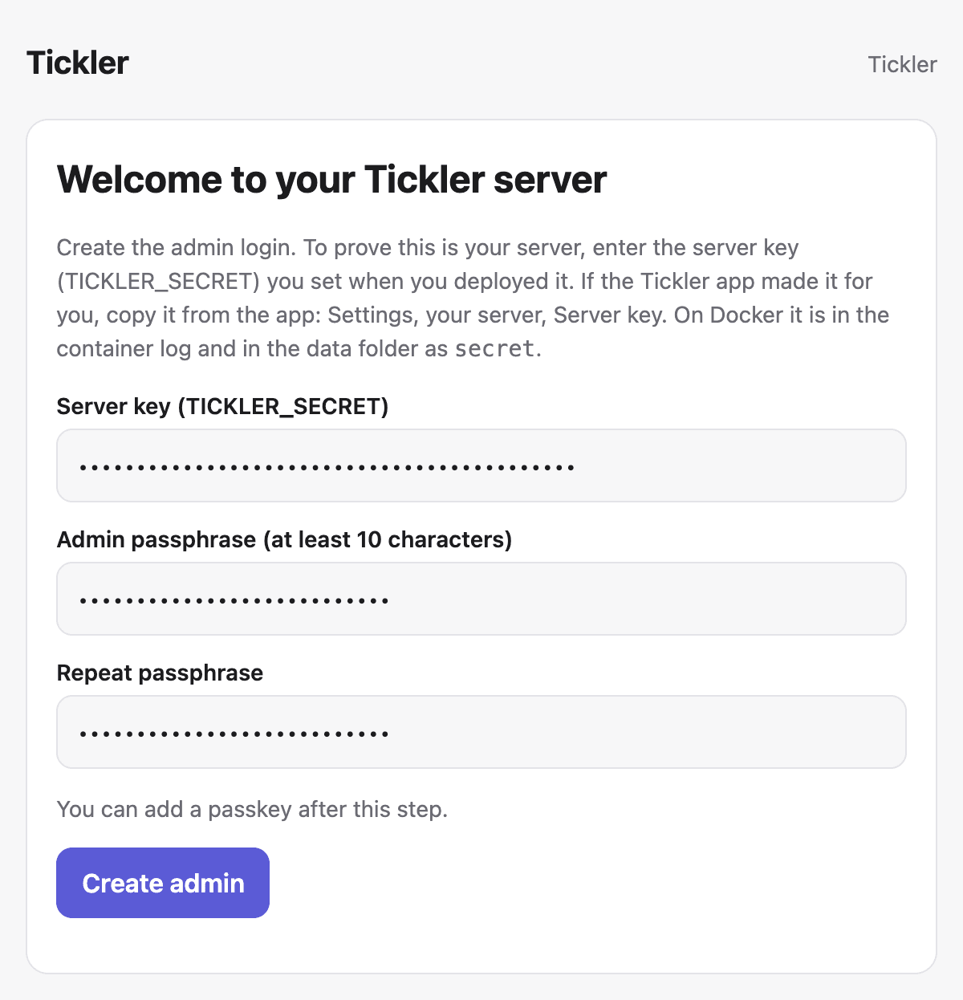

# Deploy with Docker

Run your Tickler server on your own computer, NAS or VPS, in one SQLite file you own. About 5 minutes if Docker is installed.

## Save the compose file

Make a folder called `tickler` and save this inside it as `docker-compose.yml`. Replace the secret with a long random value from `openssl rand -base64 32`.

```yaml
services:
  tickler:
    image: ghcr.io/arpitj007/tickler-server:latest
    container_name: tickler
    restart: unless-stopped
    ports:
      - "8787:8787"
    volumes:
      - ./data:/data
    environment:
      # A long random value. Make one with: openssl rand -base64 32
      TICKLER_SECRET: "paste-your-long-random-value-here"
      # Your public address, once you have one (see the public URL guides).
      # TICKLER_PUBLIC_URL: "https://tickler.example.com"
```

## Start the server

In that folder, run:

```
docker compose up -d
```

Your entries live in `data/tickler.sqlite` in that folder.

## Claim your server

1. Open `http://localhost:8787/setup`. From another device, use the machine's address, like `http://192.168.1.20:8787/setup`.
2. Enter your `TICKLER_SECRET` and choose a passphrase.
3. Press **Create admin**. Add a passkey later, once you have HTTPS.



## Add a public address if you need one

Your home network is enough for the app at home and for coding tools on your computers. Away from home, the Claude apps, ChatGPT and store webhooks need public HTTPS: use [Cloudflare Tunnel](public-url-cloudflare-tunnel.md) or [Tailscale Funnel](public-url-tailscale-funnel.md).

## Troubleshooting

- **No Compose:** run this one command instead, then open setup the same way. Write down the secret it prints in the log.

```
docker run -d --name tickler --restart unless-stopped \
  -p 8787:8787 \
  -v tickler-data:/data \
  -e TICKLER_SECRET="$(openssl rand -base64 32)" \
  ghcr.io/arpitj007/tickler-server:latest
```

- **Updating:** in your `tickler` folder, run `docker compose pull`, then `docker compose up -d`. Database changes run by themselves.
- **Updating without Compose:** run `docker pull ghcr.io/arpitj007/tickler-server:latest`, then `docker stop tickler && docker rm tickler`, then the `docker run` command again with the **same** `TICKLER_SECRET`.
- **Backing up:** stop, copy the folder, start again. Keep your `TICKLER_SECRET` with the backup.

```
docker compose stop
cp -r data "tickler-backup-$(date +%F)"
docker compose start
```

- **Backing up while running:** this is safe while Tickler writes. Then copy `data/backup.sqlite` somewhere safe.

```
docker run --rm -v "$PWD/data:/data" alpine \
  sh -c "apk add -q sqlite && sqlite3 /data/tickler.sqlite '.backup /data/backup.sqlite'"
```

- **Restoring:** stop the server, put the backup back as `data/tickler.sqlite`, delete any `tickler.sqlite-wal` and `tickler.sqlite-shm` files, and start it.
- **Passkey won't work over http:** passkeys need HTTPS or `localhost`. Use the passphrase for now.
- **Next:** [pair your phone](pair.md) and [connect your AI tools](connect/claude-code.md).
