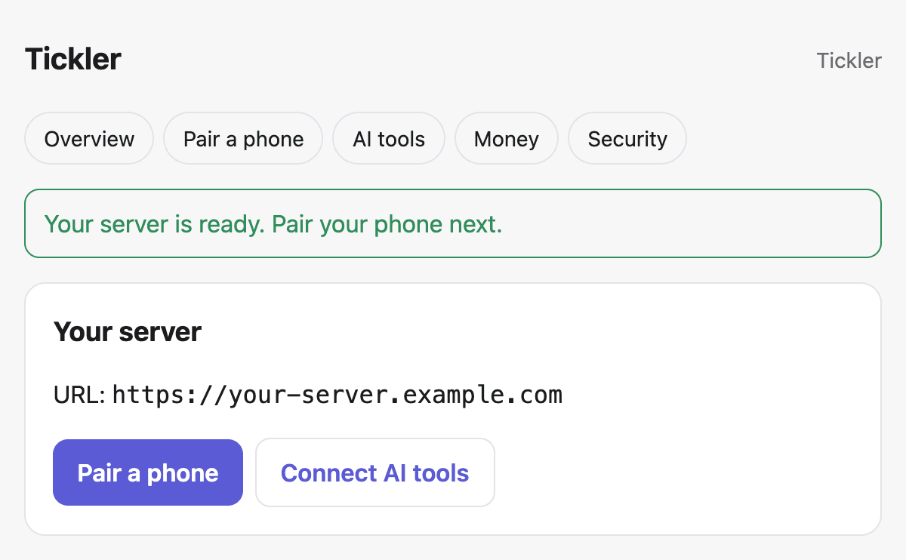
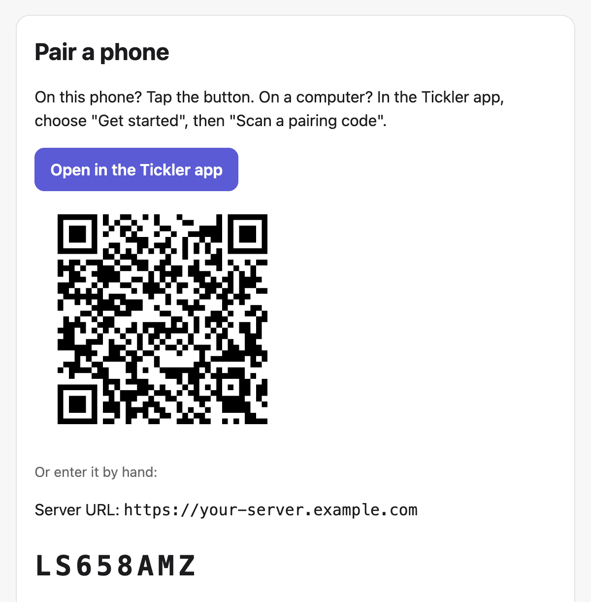
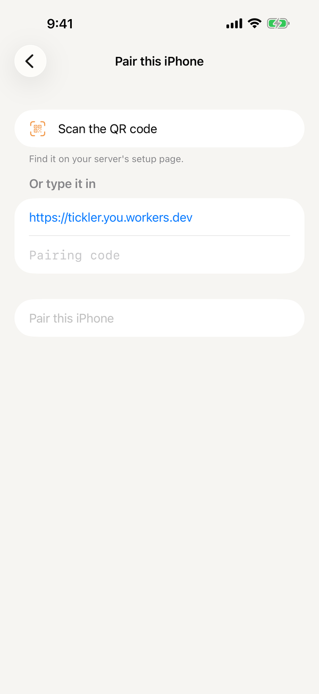

# I already have a server

Connect the app to a Tickler server that's already running, for example one a family member set up. Takes about a minute.

## Open setup on a computer

Open your server's address with `/setup` at the end, and sign in with your passkey or passphrase.

## Make a pairing code

Press **Pair a phone**. A QR code and an 8 character code appear. They work once, for 10 minutes.

## Scan it with the app

In the app, choose **Scan a pairing code** and point the camera at the screen. Or type the address and the code under **Or type it in**.

## Troubleshooting

- **Can't reach the server:** the address starts with `https://` (or `http://` at home), with no `/setup` or `/mcp` at the end.
- **The server is at home:** join the same Wi-Fi, or give it a public address with [Cloudflare Tunnel](public-url-cloudflare-tunnel.md) or [Tailscale Funnel](public-url-tailscale-funnel.md).
- **More than one server:** add another in **Settings**, then **Servers** (Tickler Pro).
- **Code problems:** see [Pair your phone](pair.md).
