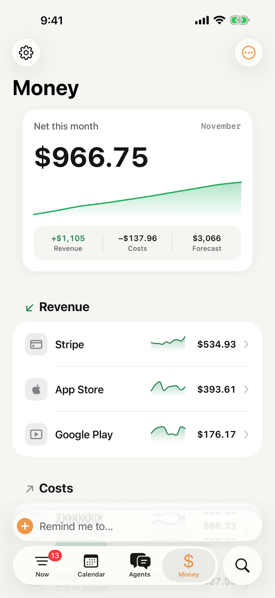
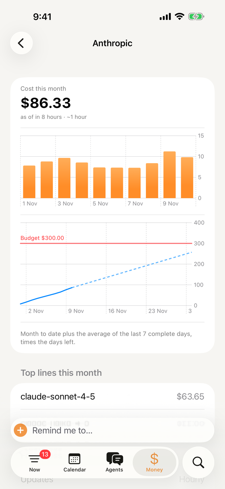
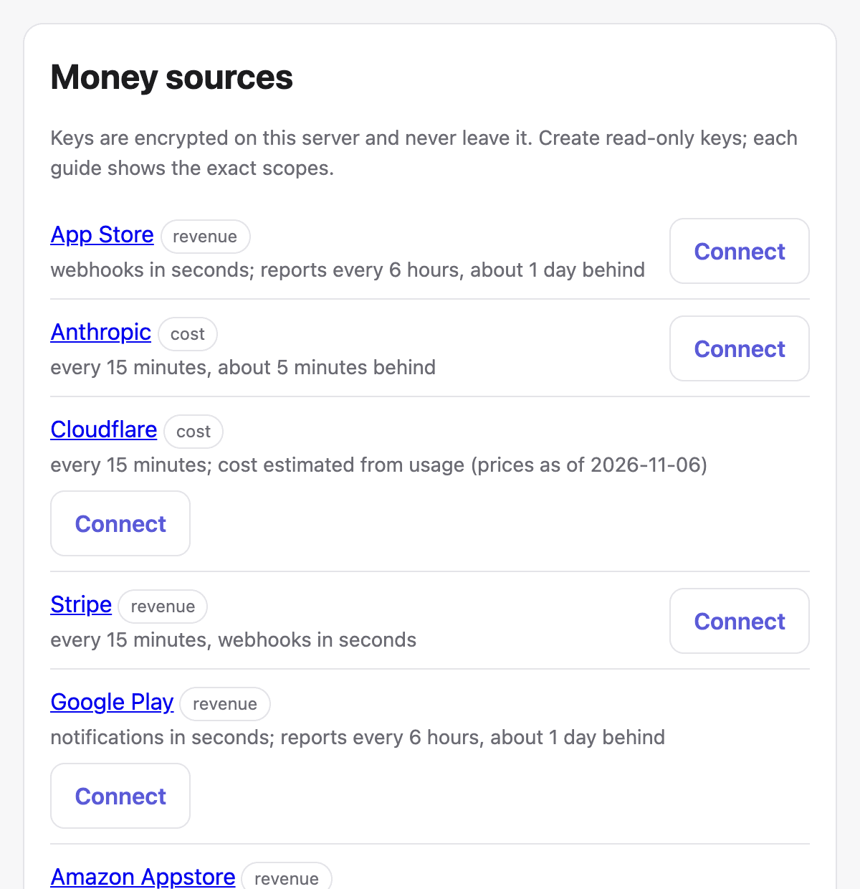

# Money

See what your apps earn and what your services cost this month, with a month-end forecast. About 5 minutes per source.

## Open the Money tab

The Money tab shows revenue, costs, net and the forecast, with a card per store and service. Every number shows when it was fetched. Money is part of Tickler Pro; demo data is free.

## Pick a source

Tap a provider, like Stripe or AWS, and open its **Guide**. It shows exactly which **read-only** key to create, with the smallest permissions that work.

## Paste the key and test

Paste the key in the app, or on your server's setup page under **Money**, then press **Test**. You see **Connected** or the provider's own error. Your server encrypts every key; the app keeps no copy.

## Set a budget

Set a monthly budget for a service, or for all costs. At 50%, 80% and 100% (you can change the steps), Tickler adds an Important entry in a **Money** project and notifies you, once per step per month.

## Troubleshooting

- **Needs a public URL:** store webhooks need a public address. On Docker, set up a tunnel first.
- **Numbers look old:** each source has its own delay:

| Source | How fast |
| --- | --- |
| Store sales through webhooks (App Store, Google Play, Amazon, Stripe) | seconds |
| Anthropic, Cloudflare, Stripe balances | every 15 minutes |
| OpenAI, GitHub | hourly |
| App Store and Google Play reports | about a day behind (the stores' own delay) |
| AWS, Google Cloud | a few hours to a day behind |
| Fixed costs and manual numbers | whenever you change them |

- **Forecast method:** the provider's own forecast when it has one (AWS, Google Cloud). Otherwise month to date plus the last 7 complete days' average times the days left.
- **Fixed costs:** add developer fees, domains or hosting under **Money**, then **Fixed costs**. Tickler adds an Important entry 14 days before each renewal.
- **Other currencies:** shown separately and left out of totals, unless the provider gives a converted amount.
- **All provider guides:** see [Money providers](providers/index.md).
