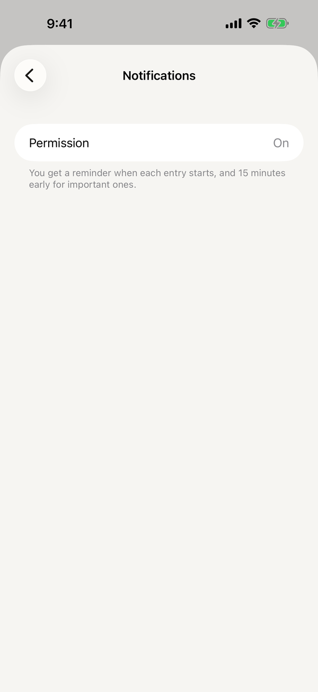

# Notifications

Get reminders when entries are due and alerts when budgets are crossed, planned on your phone. About 1 minute.

## Allow notifications

When the app asks, tap **Allow**. On Android, also allow **alarms and reminders** so reminders fire at the exact minute.

## Choose what to get

In **Settings**, then **Notifications**, turn on what you want: entry reminders (plus 15 minutes early for important ones), budget alerts, and money alerts (Tickler Pro).

## Keep background sync on

Reminders are planned on your phone after each sync. On iPhone, keep **Background App Refresh** on for Tickler. On Android, set Tickler's battery use to **Unrestricted** if your phone saves battery aggressively.

## Troubleshooting

- **Budget or sales alerts are late:** they arrive at the next background sync, about once an hour, later in Low Power mode or Battery Saver.
- **A new entry for the next few minutes didn't alert:** your phone hadn't synced yet. Opening the app syncs right away.
- **Critical entries during Focus:** on iPhone, allow **Time Sensitive** notifications for Tickler.
- **Privacy:** Tickler sends no pushes from the internet. Nothing leaves your phone or your server.
- **Instant alerts:** an optional push relay that sends only a contentless "sync now" signal is planned for version 1.1, off by default.
