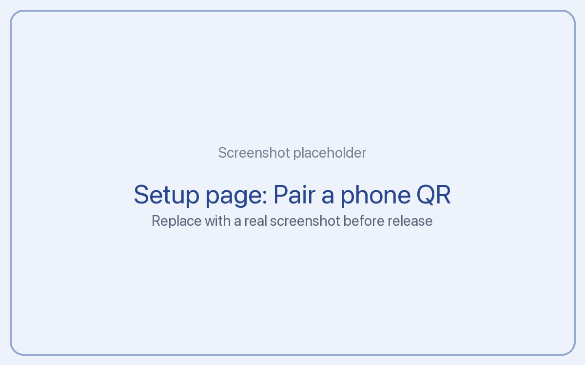
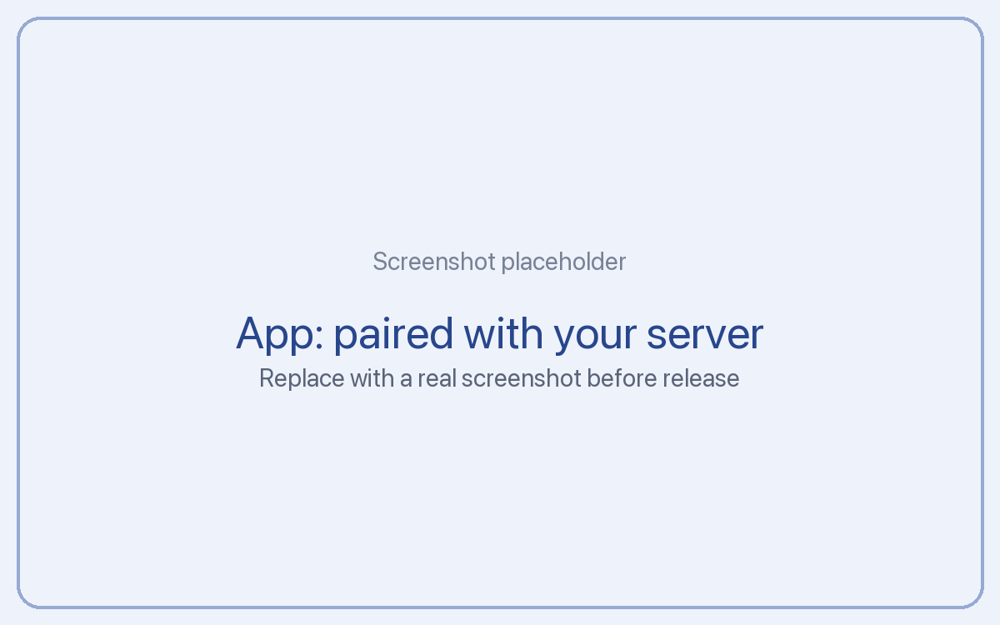

# Pair your phone

Pairing connects the Tickler app on your iPhone or Android phone to your own server. It takes about a minute. Your server gives the phone its own key, which stays in the phone's secure storage (the iPhone Keychain or the Android Keystore).

## Step 1: Open setup on a computer

Open your server's setup page in a browser:

```
{{SERVER_URL}}/setup
```

Log in with your passkey or passphrase.

## Step 2: Make a pairing code

Press **Pair a phone**. The page shows:

- a **QR code**
- the **server address** and an **8 character code** as text, in case you can't scan



The code works once and expires after 10 minutes. If it runs out, press **Pair a phone** again.

## Step 3: Scan it with the app

1. In the Tickler app, go to **Pair this phone** (during setup) or **Settings**, then **Servers**, then **Add server**.
2. Tap **Scan QR code** and point the camera at the screen. The app asks for camera access the first time; it only uses the camera for this.
3. Give the phone a name if you want (like "My iPhone"), then tap **Pair**.



You can also scan the QR code with the phone's own camera app. It opens Tickler and fills everything in.

## No camera? Type it in

Tap **Enter code instead**, then type:

- the server address, exactly as shown on the setup page
- the 8 character code (capital letters and numbers; there is no letter O or I and no number 0 or 1, so you can't mix them up)

## It worked

The app shows your server's name and starts syncing. If your AI tools already added entries, they appear on the Timeline within a few seconds.

## Unpairing a phone

- **From the phone:** Settings, then **Disconnect and erase**. This removes the server, its key and all Tickler data from the phone.
- **From setup:** if you lose a phone, open setup, go to **Devices** and press **Revoke** next to it. That phone can no longer read or change anything.

## If pairing fails

- **"Code expired":** make a new one with **Pair a phone**. Each code lasts 10 minutes.
- **"Code not found":** check for typos, or make a new code. A code works only once.
- **"Can't reach the server":** your phone can't reach the address. If the server is at home, join the same Wi-Fi, or set up a public address.
- **"Too many tries":** wait a minute and try again. Setup slows down repeated attempts to keep guessers out.
