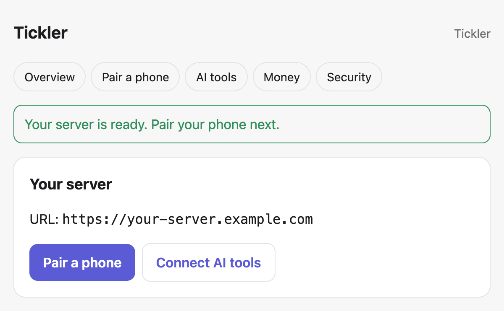
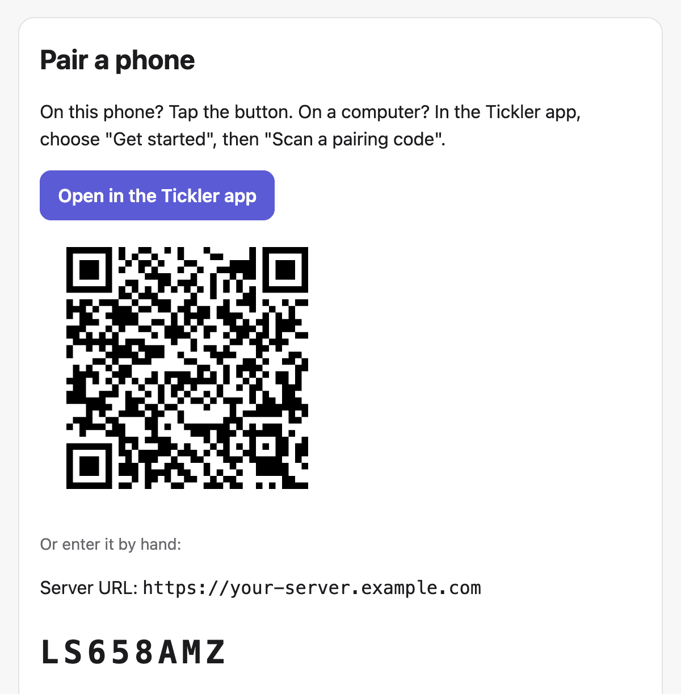
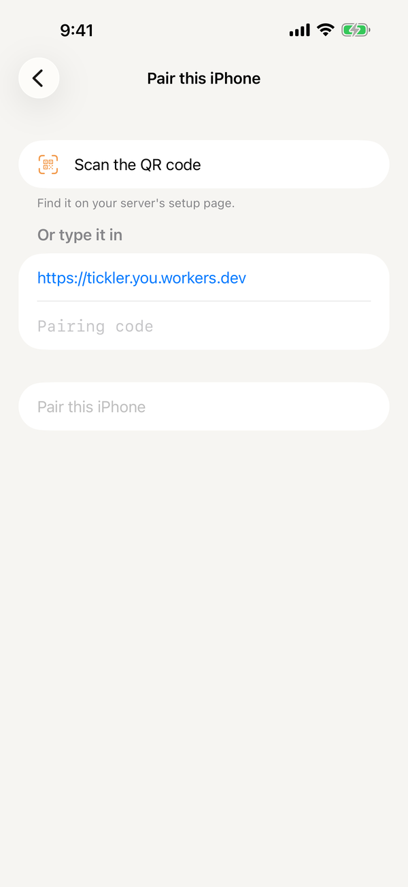

# Pair your phone

Connect the Tickler app on your phone to your own server, using a QR code from setup. Takes about a minute.

## Open setup on a computer

Open this address in a browser and sign in with your passkey or passphrase:

```
{{SERVER_URL}}/setup
```



## Make a pairing code

Press **Pair a phone**. A QR code and an 8 character code appear. The code works once, for 10 minutes.



## Scan it with the app

1. In the app, open **Pair this iPhone** (on Android, **Pair this phone**).
2. Tap **Scan the QR code** and point the camera at the screen.
3. Your server's name appears and your entries start syncing.



## Troubleshooting

- **No camera:** type the address and the code under **Or type it in**. Codes have no O, I, 0 or 1.
- **Code expired:** press **New code**. Each code lasts 10 minutes.
- **Code not found:** check for typos, or make a new code. A code works only once.
- **Can't reach the server:** if the server is at home, join the same Wi-Fi, or set up a public address.
- **Too many tries:** wait a minute and try again.
- **Unpair this phone:** in the app, **Settings**, then **Disconnect and erase**.
- **Lost a phone:** in setup, find it under **Phones** and press **Revoke**.
