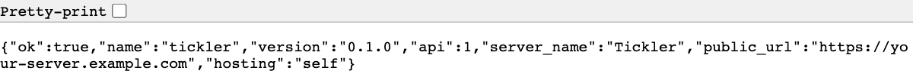

# Public URL with Cloudflare Tunnel

Give your Docker server a free public HTTPS address without opening ports. About 10 minutes, with a domain on Cloudflare.

## Create the tunnel

1. In the Cloudflare dashboard, go to **Networking**, then **Tunnels**, and press **Create Tunnel**. (Some accounts: **Zero Trust**, **Networks**, **Tunnels**.)
2. Choose **Cloudflared** and name it `tickler`.
3. Choose **Docker** and copy the token: the long value after `--token`.

## Run the tunnel next to Tickler

Make your `docker-compose.yml` look like this, with your token and your future address. Then run `docker compose up -d`.

```yaml
services:
  tickler:
    image: ghcr.io/arpitj007/tickler-server:latest
    container_name: tickler
    restart: unless-stopped
    volumes:
      - ./data:/data
    environment:
      TICKLER_SECRET: "paste-your-long-random-value-here"
      TICKLER_PUBLIC_URL: "https://tickler.example.com"

  tunnel:
    image: cloudflare/cloudflared:latest
    restart: unless-stopped
    command: tunnel --no-autoupdate run --token paste-your-tunnel-token-here
    depends_on:
      - tickler
```

## Point an address at Tickler

1. In the dashboard, open the `tickler` tunnel. It should say **Healthy**.
2. Add a **Published application** route (older dashboards: **Public hostname**).
3. Pick a subdomain, like `tickler`, and your domain.
4. Set the service to `http://tickler:8787` and save.

## Check it

Open your new address with `/api/health` at the end, like `https://tickler.example.com/api/health`. You should see `"ok":true`.



## Troubleshooting

- **Just testing, no domain:** run this. It prints a temporary `trycloudflare.com` address that works until you stop it.

```
docker run --rm --network host cloudflare/cloudflared:latest \
  tunnel --no-autoupdate --url http://localhost:8787
```

- **Mac or Windows:** `--network host` may not work in Docker Desktop. Install `cloudflared` and run `cloudflared tunnel --url http://localhost:8787`.
- **AI tools or webhooks can't connect:** don't put Cloudflare Access login screens in front of Tickler. Tickler checks its own tokens.
- **No domain on Cloudflare:** use [Tailscale Funnel](public-url-tailscale-funnel.md) instead.
- **Want a passkey:** open `/setup` on the new HTTPS address and add one.
- **Store webhooks:** they go to your address plus `/hooks/` and the store's name. Each provider guide shows the exact address.
