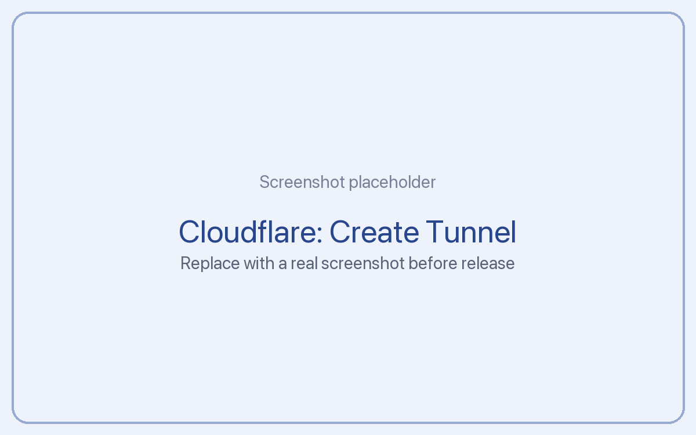

# Public URL with Cloudflare Tunnel

If you run Tickler with Docker at home, a Cloudflare Tunnel gives it a public HTTPS address, without opening any ports on your router. It's free.

You need a public address for: the app away from home, the Claude apps and ChatGPT, and store webhooks. You don't need one if you only use Tickler on your own network.

**Time:** about 10 minutes for a permanent address. 1 minute for a quick test address.

## Quick test (no account, temporary)

To try it right now, run this on the machine that runs Tickler:

```
docker run --rm --network host cloudflare/cloudflared:latest \
  tunnel --no-autoupdate --url http://localhost:8787
```

After a few seconds it prints an address ending in `trycloudflare.com`. That address works until you stop the command.

This is for testing only: the address changes every time, and Cloudflare gives no uptime guarantee for quick tunnels. On a Mac or Windows with Docker Desktop, `--network host` may not work; install `cloudflared` directly instead and run `cloudflared tunnel --url http://localhost:8787`.

## Permanent address (recommended)

You need a free Cloudflare account and a domain that uses Cloudflare for DNS (you can buy one in the Cloudflare dashboard for the usual registry price, or move an existing one).

### Step 1: Create the tunnel

1. In the Cloudflare dashboard, go to **Networking**, then **Tunnels**, and press **Create Tunnel**. (In some accounts this is under **Zero Trust**, then **Networks**, then **Tunnels**.)
2. Choose **Cloudflared**, name it `tickler`, and save.
3. Cloudflare shows install commands. Choose **Docker** and copy the **token**: the long value after `--token`.



### Step 2: Run the tunnel next to Tickler

Add a second service to your `docker-compose.yml`, so the file looks like this:

```yaml
services:
  tickler:
    image: ghcr.io/arpitj007/tickler-server:latest
    container_name: tickler
    restart: unless-stopped
    volumes:
      - ./data:/data
    environment:
      TICKLER_SECRET: "paste-your-long-random-value-here"
      TICKLER_PUBLIC_URL: "https://tickler.example.com"

  tunnel:
    image: cloudflare/cloudflared:latest
    restart: unless-stopped
    command: tunnel --no-autoupdate run --token paste-your-tunnel-token-here
    depends_on:
      - tickler
```

Replace `tickler.example.com` with the address you'll pick in step 3. You can remove the `ports` lines from the `tickler` service now: the tunnel reaches it inside Docker, so nothing needs to be open on your machine.

Start both:

```
docker compose up -d
```

### Step 3: Point an address at Tickler

1. Back in the dashboard, open the `tickler` tunnel. Its status should be **Healthy**.
2. Add a route: **Published application** (older dashboards call it **Public hostname**).
3. Pick a subdomain, like `tickler`, and your domain.
4. Set the service to `http://tickler:8787`. (`tickler` is the container's name in the compose file.)
5. Save.

### Step 4: Check it

Open your new address with `/api/health` at the end, for example `https://tickler.example.com/api/health`. You should see a short message that includes `"ok": true`.

Then open `/setup` on the new address. If you set up a passphrase before, you can now add a passkey too.

## Good to know

- Don't put Cloudflare Access (login screens) in front of Tickler. AI tools and webhooks can't get past them. Tickler checks its own tokens on every request.
- The tunnel only exposes Tickler, not the rest of your network.
- Store webhooks (App Store, Google Play, Amazon, Stripe) go to your public address plus `/hooks/` and the store's name. Each provider guide gives the exact address to paste.
