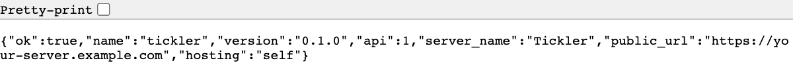

# Public URL with Tailscale Funnel

Give your Docker server a free public HTTPS address with no domain and no router changes. About 10 minutes.

## Install Tailscale

Install [Tailscale](https://tailscale.com/download) on the machine that runs Tickler, and log in. The free personal plan is enough.

## Start Funnel

Run this on that machine. On a Mac with the Tailscale app, leave out `sudo`.

```
sudo tailscale funnel --bg 8787
```

If it prints a link, open it, approve Funnel, and run the command again. It prints your address, like `https://homeserver.your-tailnet.ts.net`.

## Tell Tickler its address

Add your address to the `environment` section of your `docker-compose.yml`, then run `docker compose up -d`:

```yaml
      TICKLER_PUBLIC_URL: "https://homeserver.your-tailnet.ts.net"
```

## Check it

Open your address with `/api/health` at the end. You should see `"ok":true`. The first request can take a few seconds.



## Troubleshooting

- **Funnel isn't allowed:** in the Tailscale admin console, turn on **MagicDNS** and **HTTPS certificates** under **DNS**, and the funnel permission under **Access controls**.
- **Turn it off:** run `sudo tailscale funnel reset`. Tickler keeps working on your own network.
- **Only your own devices:** use `tailscale serve` instead and install Tailscale on your phone. The Claude apps, ChatGPT and webhooks then can't reach Tickler.
- **Bandwidth limits:** Funnel has fixed limits, but Tickler sends very little data.
