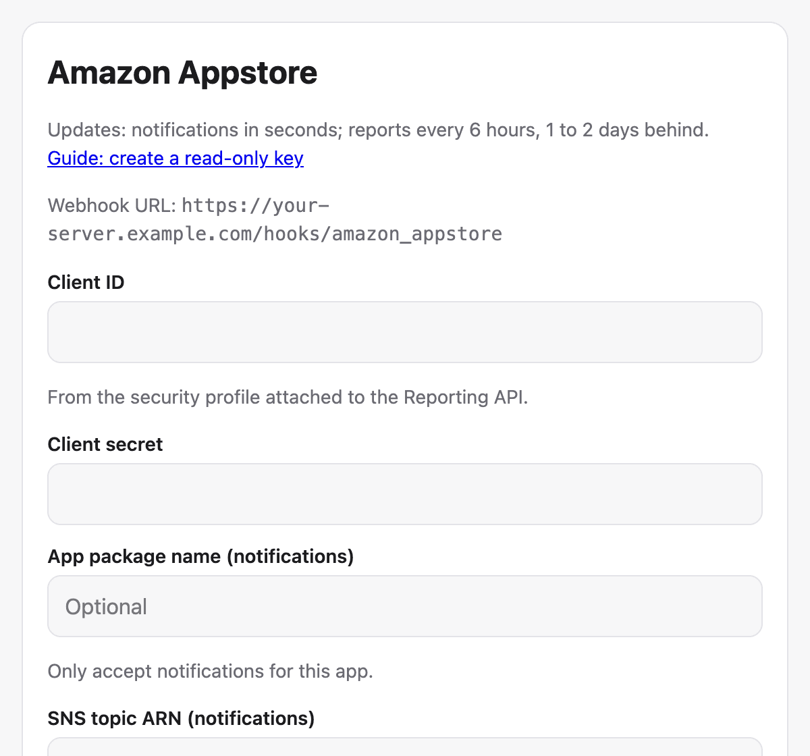

# Amazon Appstore (Fire TV, Fire tablets)

See Amazon Appstore sales and earnings, with a live feed of purchases and subscriptions. About 10 minutes, as a Developer Console Admin.

## Create a security profile

1. In the Amazon Developer Console, open **My Settings**, then **API Access**, then **Reporting API**.
2. Click **Create a new security profile**, name it `ReportingAPI_Tickler`, and save.
3. On its **Web Settings** tab, copy the **Client ID** and **Client Secret**.
4. Back on **Reporting API**, choose the profile and click **Attach**.

## Paste it into Tickler

In **Money**, open **Amazon Appstore**, paste the Client ID and Client Secret, save, and press **Test**.

## Add the notifications endpoint

1. Open **My Apps**, choose the app, then **App Services**, then **Real-Time Notifications**.
2. Click **Add an Endpoint**, enter `https://<your-server>/hooks/amazon_appstore`, and submit.

## Confirm the endpoint

Tickler shows a **confirmation token** on `/setup` once Amazon reaches it. Paste it into **Confirmation token** in the console and click **Confirm**. It's valid for 48 hours.

## Troubleshooting

- **Notifications need a public URL:** on Docker, set up a tunnel first.
- **invalid_client:** wrong client secret, or the profile isn't attached to the Reporting API.
- **403 Request is not authorized:** the token expired, or the report is out of scope.
- **No numbers this month:** the report may not exist until the first sale. Reports lag up to 48 hours.
- **No token shown:** use **Resend** in the console.
- **Is the key safe:** it can only download reports, not read payments. Amazon suggests a new profile every 6 months.
- **Other currencies:** only your base currency counts in totals.
