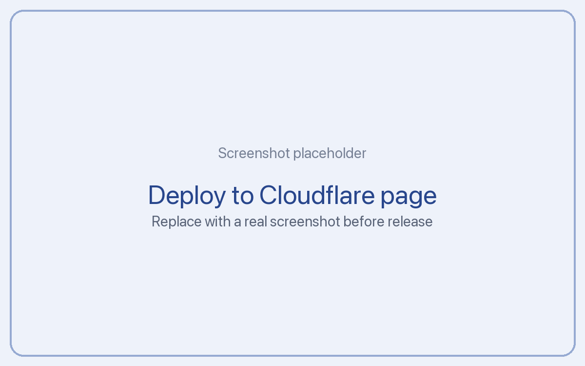

# Amazon Appstore (Fire TV, Fire tablets)

Shows daily sales and estimated earnings by marketplace and a live feed of purchases,
subscriptions, renewals, cancellations and grace periods.

- **Reports, pulled every 6 hours:** the monthly sales report from the Reporting API. Amazon
  updates it at least daily with up to 48 hours of lag (one Amazon page says every 6 hours).
- **Live feed (seconds):** Appstore Real-Time Notifications, delivered by Amazon SNS.
- Amounts are in each marketplace's currency; only your base currency counts in totals.
- Days are the marketplace's local date as Amazon reports it.

## 1. Create a security profile for the Reporting API

You need an Admin account in the Amazon Developer Console.

1. Open **My Settings > API Access** and click **Reporting API**.
   
2. Click **Create a new security profile**. Name it `ReportingAPI_Tickler`, save.
3. On the profile's **Web Settings** tab, copy the **Client ID** and **Client Secret**.
4. Back on **API Access > Reporting API**, choose the profile and click **Attach**.

The profile can only download reports with the `adx_reporting::appstore:marketer` scope, which
cannot read payments. Amazon recommends rotating profiles every 6 months.

## 2. Paste into Tickler

| Field | Value |
| --- | --- |
| Client ID | from step 3 |
| Client secret | from step 3 |
| App package name (optional) | to accept notifications for one app |
| SNS topic ARN (optional) | pins notifications to your topic (shown on /setup after the first message) |

Click **Test**: Amazon must issue a Reporting API token.

## 3. Real-Time Notifications (live feed)

Needs a public URL.

1. Open **My Apps**, choose the app, then **App Services > Real-Time Notifications** and
   **Add an Endpoint**.
2. URL: `https://<your-server>/hooks/amazon_appstore`. Submit.
   
3. Amazon sends an SNS subscription confirmation. Tickler verifies it and shows the
   **confirmation token** on `/setup` (it also confirms through the SNS SubscribeURL). Paste the
   token into **Confirmation token** in the console and click **Confirm**. The token is valid for
   48 hours; use **Resend** if needed.

Tickler verifies every SNS message: the signing certificate must come from an
`sns.<region>.amazonaws.com` HTTPS URL, SignatureVersion 1 (SHA1) or 2 (SHA256), and the signature
must match. Anything else gets HTTP 401.

Mapping: consumable and entitlement purchased (purchase), cancelled (refunded), subscription
purchased (subscribed), renewed and free trial converted (renewed), cancelled and auto renewal
off (cancelled), in grace period (billing issue). Live App Testing transactions are skipped.

## Troubleshooting

- **invalid_client:** wrong client secret, or the profile is not attached to the Reporting API.
- **403 Request is not authorized:** the token expired or the report is out of scope.
- **No numbers for this month yet:** the report may not exist until the first sale.

## Sources

Checked: 2026-11-06

- https://developer.amazon.com/docs/reports-promo/reporting-API.html
- https://developer.amazon.com/docs/reports-promo/sales-reports.html
- https://developer.amazon.com/docs/in-app-purchasing/real-time-notifications.html
- https://developer.amazon.com/docs/in-app-purchasing/use-rtn.html
- https://docs.aws.amazon.com/sns/latest/dg/sns-verify-signature-of-message.html
- https://docs.aws.amazon.com/sns/latest/dg/http-header.html

Verify: whether opening SubscribeURL alone confirms an RTN endpoint (Amazon documents the console
token); the mapping of `SUBSCRIPTION_CANCELLED` versus `SUBSCRIPTION_AUTO_RENEWAL_OFF` (both are
counted as cancelled, so one cancellation may count twice).

## Screenshots needed

- `amazon_appstore-1.png`: My Settings > API Access > Reporting API
- `amazon_appstore-6.png`: App Services > Real-Time Notifications > Add an Endpoint
