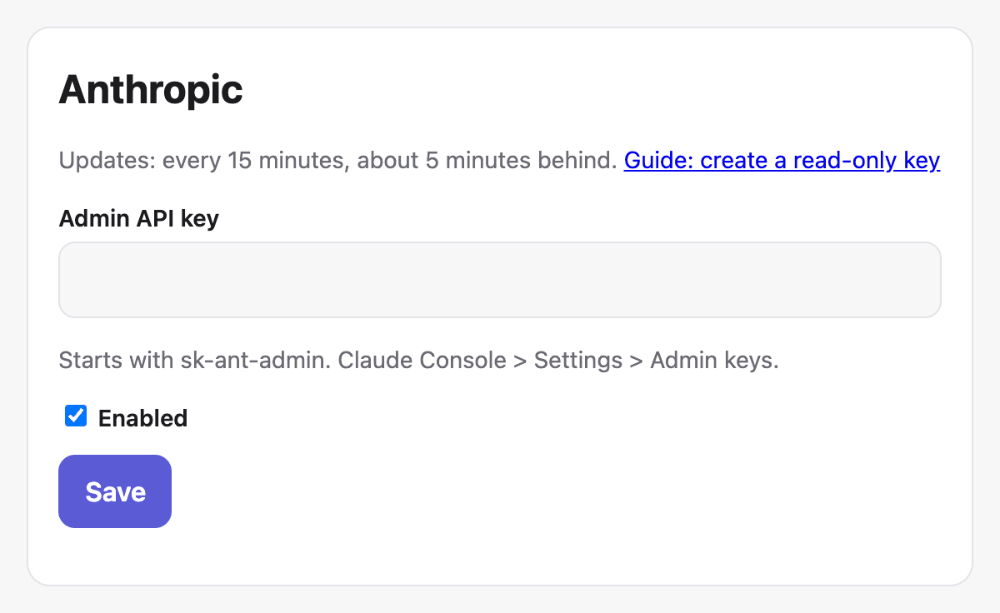

# Anthropic

See your Claude API spend and tokens per model, from Anthropic's Admin API. About 5 minutes, as an organization admin.

## Use an organization account

Open [platform.claude.com/settings/organization](https://platform.claude.com/settings/organization). If it offers to set up an organization, do it. Your keys, billing and usage stay. Admin keys don't exist on individual accounts.

## Create an admin key

1. Open [platform.claude.com/settings/admin-keys](https://platform.claude.com/settings/admin-keys).
2. Click **Create admin key**, name it `Tickler`, pick an expiration, and click **Add**.
3. Copy the key (`sk-ant-admin01-...`). It's shown once.

## Paste it into Tickler

In **Money**, open **Anthropic**, paste the key, save, and press **Test**. It reads your organization's name.

## Troubleshooting

- **Admin keys can't be read-only:** every admin key can manage members and keys. Use one only for Tickler, with an expiration, and revoke it if anything looks wrong. Tickler only reads.
- **Key "not configured":** it must start with `sk-ant-admin`. A normal `sk-ant-api...` key can't read usage.
- **Admin keys page not found:** you're on an individual account. Set up an organization first.
- **HTTP 401:** the key was revoked or expired. Make a new one.
- **HTTP 403:** you're not an admin of the organization. Ask its owner for the **admin** role.
- **Priority Tier:** it's billed differently and isn't in the cost report.
