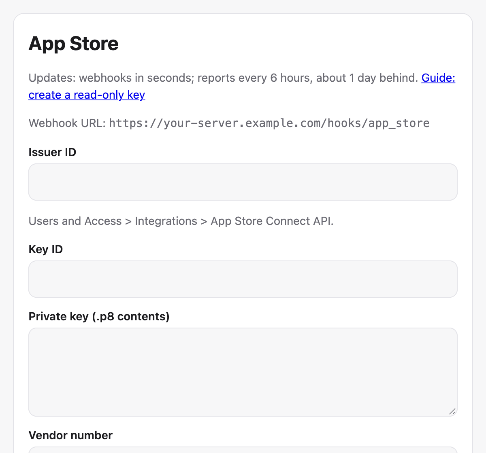

# App Store

See App Store proceeds, units, subscriptions, trials and refunds, with a live feed of sales. About 5 minutes, as an App Store Connect Admin.

## Create a team API key

1. In [App Store Connect](https://appstoreconnect.apple.com), open **Users and Access**, then **Integrations**, then **App Store Connect API**, then **Team Keys**.
2. Click **Generate API Key**, name it `Tickler`, and choose the **Finance** role.
3. Download the `.p8` file (only once), and copy the **Issuer ID** and **Key ID**.

## Find your vendor number

Open **Payments and Financial Reports**. The vendor number is at the top left, under your legal entity name.

## Paste it into Tickler

In **Money**, open **App Store**. Fill in the Issuer ID, Key ID, vendor number, and the whole `.p8` file, including the BEGIN and END lines. Save and press **Test**.

## Turn on the live feed

1. In App Store Connect, open your app, then **App Information**.
2. Under **App Store Server Notifications**, set the **Production Server URL** to `https://<your-server>/hooks/app_store`.
3. Choose **Version 2** and save.

## Troubleshooting

- **Live feed needs a public URL:** on Docker, set up a tunnel first.
- **Individual keys don't work:** Apple's sales and finance reports need a team key.
- **Why Finance:** it's the smallest role Apple documents for both report types. It can't change apps, prices or users.
- **HTTP 401:** check the Issuer ID and Key ID, and paste the full `.p8`. The key may be revoked.
- **HTTP 403:** the key's role can't read reports. Make a Finance key.
- **No numbers yet:** daily reports appear the next morning, Pacific time. Monthly Finance reports come early next month.
- **Webhook 401:** the request wasn't signed by Apple, or the server clock is far off.
- **Testing with sandbox:** set the same URL as **Sandbox Server URL**, and **Record sandbox notifications** to `true` in Tickler.
- **Other currencies:** only your base currency counts in totals; the rest are listed separately.
- **Adding the `.p8` from a computer:** see [Money providers](index.md).
