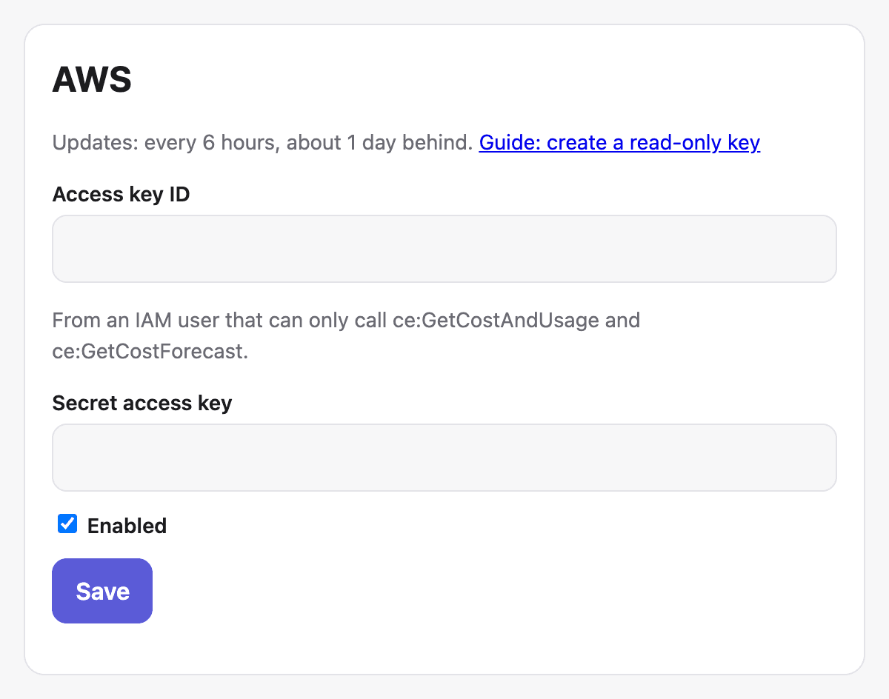

# AWS

See AWS cost by service and AWS's own month-end forecast, with a key that can only read costs. About 10 minutes.

## Turn on Cost Explorer

As the root user or an admin, open **Billing and Cost Management**, then **Cost Explorer**, and click **Launch Cost Explorer**. Data appears within about a day.

## Create a cost-only user

1. In **IAM**, open **Users**, then **Create user**. Name it `tickler-cost-read`, without console access or policies.
2. Open the user, then **Permissions**, **Add permissions**, **Create inline policy**, **JSON**.
3. Paste this and name it `TicklerCostExplorerRead`.

```json
{
  "Version": "2012-10-17",
  "Statement": [
    {
      "Effect": "Allow",
      "Action": ["ce:GetCostAndUsage", "ce:GetCostForecast"],
      "Resource": "*"
    }
  ]
}
```

## Create an access key

On the user, open **Security credentials**, then **Create access key**. Choose **Application running outside AWS**, and copy the access key ID and secret. The secret is shown once.

## Paste it into Tickler

In **Money**, open **AWS**, paste the access key ID and secret, save, and press **Test**.



## Troubleshooting

- **It costs a little:** each Cost Explorer request costs USD 0.01, so about USD 2.40 a month at 4 syncs a day.
- **AccessDeniedException:** check the inline policy. The root user may also need to turn on **IAM user and role access to Billing information**.
- **AWS Organizations:** the management account must allow Cost Explorer for member accounts.
- **DataUnavailableException on forecast:** not enough history yet. Tickler uses its 7 day run rate.
- **SignatureDoesNotMatch or RequestExpired:** the secret is wrong, or the server clock is more than 15 minutes off.
