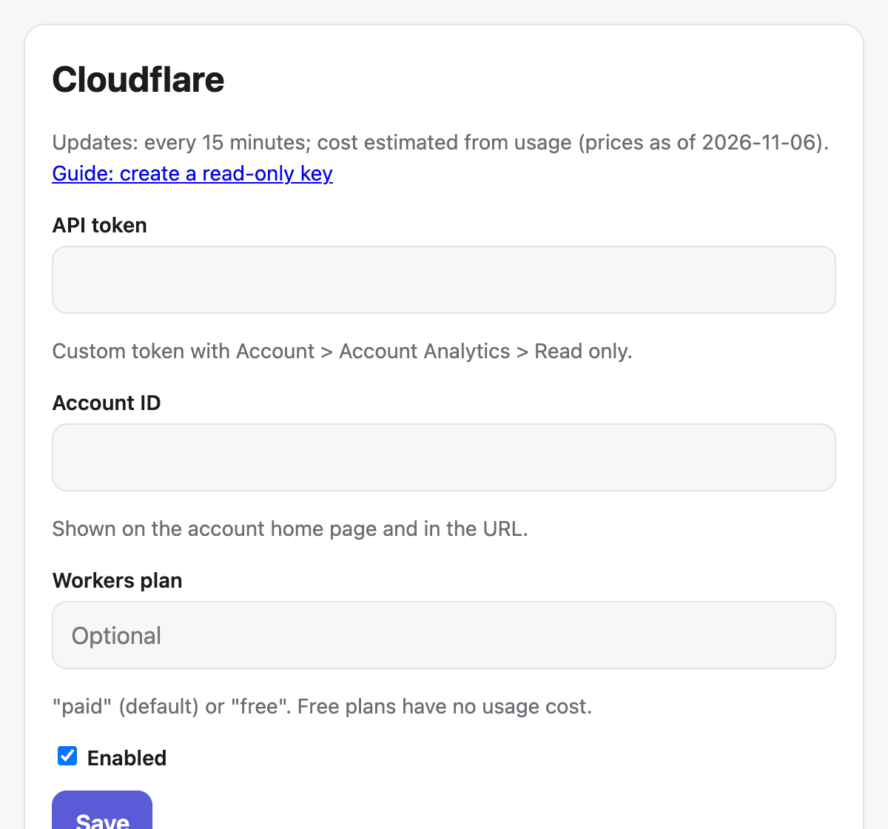

# Cloudflare

See Workers, D1, R2 and KV usage and an estimated cost, with a token that can only read analytics. About 5 minutes.

## Create a read-only token

1. In the Cloudflare dashboard, open **My Profile**, then **API Tokens**, then **Create Token**, then **Create Custom Token**.
2. Name it `Tickler (read analytics)`.
3. Add one permission: **Account**, **Account Analytics**, **Read**.
4. Under **Account Resources**, include only your account. Create it and copy the token.

## Find your account ID

Open your account home in the dashboard. The account ID is in the address (`dash.cloudflare.com/<account id>/...`) and in the **Account details** panel.

## Paste it into Tickler

In **Money**, open **Cloudflare**, paste the token and account ID, save, and press **Test**. On the free Workers plan, set the plan to `free`.

## Troubleshooting

- **"no analytics could be read":** the token lacks Account Analytics Read, or the account ID is wrong.
- **One product missing:** if a dataset fails (for example R2 isn't enabled), Tickler skips it and keeps the rest.
- **Numbers differ from the invoice:** the cost is an estimate over calendar months, while Cloudflare bills from your renewal date.
- **Not in the estimate:** Durable Objects, Queues, Workers AI, Images, Stream, R2 Infrequent Access, domains and add-ons. Add them as fixed costs.
- **Prices used (as of 2026-11-06, Workers Paid):**

| Item | Included per month | Beyond that |
| --- | --- | --- |
| Base fee | | USD 5 per month |
| Workers requests | 10 million | USD 0.30 per million |
| Workers CPU time | 30 million ms | USD 0.02 per million ms |
| D1 rows read | 25 billion | USD 0.001 per million |
| D1 rows written | 50 million | USD 1.00 per million |
| D1 storage | 5 GB | USD 0.75 per GB-month |
| R2 Class A operations | 1 million | USD 4.50 per million |
| R2 Class B operations | 10 million | USD 0.36 per million |
| R2 storage (Standard) | 10 GB-month | USD 0.015 per GB-month |
| KV reads | 10 million | USD 0.50 per million |
| KV writes, deletes, lists | 1 million | USD 5.00 per million |
