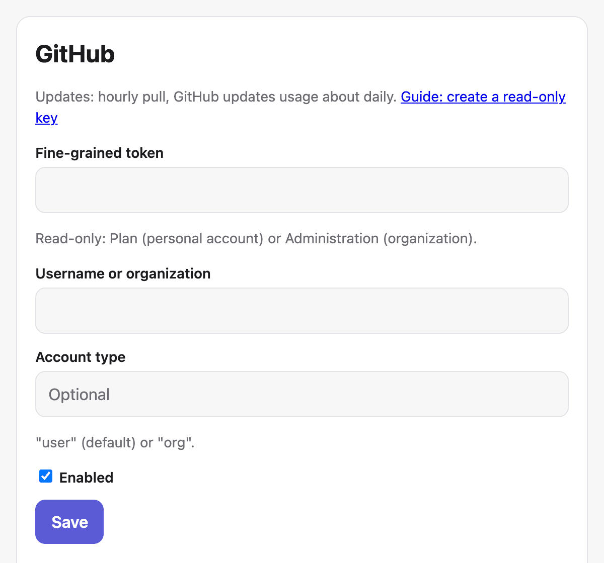
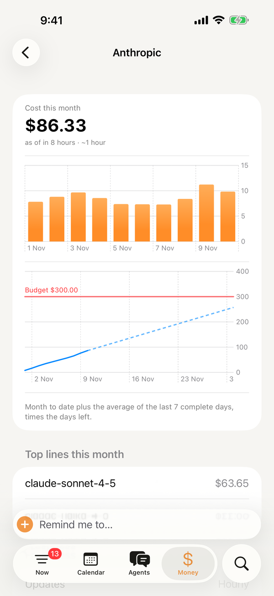

# GitHub

See GitHub spend on Actions, Copilot, storage and seats, for your account or one organization. About 3 minutes.

## Create a fine-grained token

1. In GitHub, open **Settings**, **Developer settings**, **Personal access tokens**, **Fine-grained tokens**, **Generate new token**.
2. Name it `Tickler billing`. Pick your user or the organization as owner.
3. Give it **Plan: Read-only** (personal) or **Administration: Read-only** (organization).
4. Generate it and copy it.

## Paste it into Tickler

In **Money**, open **GitHub**. Paste the token and your username or organization, and set the account type to `org` for an organization. Save and press **Test**.

## Check the numbers

Open the **Money** tab, then **GitHub**. Your spend appears after the first sync, with the time it was fetched.

## Troubleshooting

- **Organizations:** you must be an owner or billing manager, and the organization may need to approve the token.
- **Why Administration:** it's the only permission GitHub accepts for organization billing. It can read other settings but can't change anything.
- **HTTP 404:** wrong owner name, or the account isn't on the enhanced billing platform.
- **HTTP 403:** the token lacks Plan or Administration read, or the organization hasn't approved it.
- **The newest day is missing:** GitHub posts usage about once a day.
