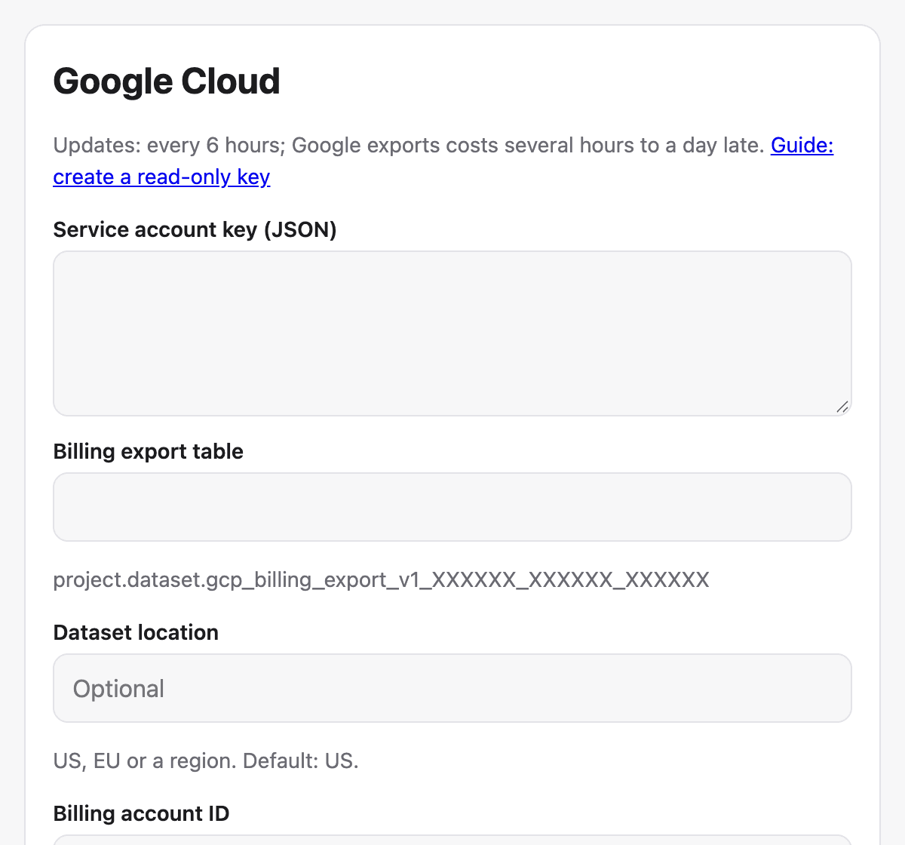

# Google Cloud

See Google Cloud cost by service and your budgets, from the billing export to BigQuery. About 15 minutes.

## Turn on the billing export

In **Billing**, open **Billing export**, then **BigQuery export**, then **Standard usage cost**, and **Edit settings**. Choose a project and a dataset, like `billing`. Data backfills within a few days.

## Create a service account

1. In the export's project, open **IAM & Admin**, then **Service Accounts**, and create `tickler-billing`.
2. Give it the project role **BigQuery Job User**, and nothing else.
3. Open it, then **Keys**, **Add key**, **Create new key**, **JSON**.

## Let it read the billing dataset

In **BigQuery**, open the billing dataset, then **Sharing**, **Permissions**, **Add principal**. Add the service account with **BigQuery Data Viewer** on that dataset only.

## Paste it into Tickler

In **Money**, open **Google Cloud**. Paste the JSON key and the table name, like `project.dataset.gcp_billing_export_v1_XXXXXX_XXXXXX_XXXXXX`. Save and press **Test**.



## Troubleshooting

- **Show budgets too:** in **Billing**, **Account management**, give the service account **Billing Account Viewer**, enable the **Cloud Billing Budget API**, and fill in **Billing account ID** in Tickler.
- **Can't create a key:** your organization blocks service account keys (`iam.disableServiceAccountKeyCreation`). An Org Policy Admin must allow them.
- **Access Denied: bigquery.jobs.create:** add BigQuery Job User on the project.
- **Access Denied: table:** add BigQuery Data Viewer on the dataset.
- **Not found: Table:** check the table name and the dataset location (`US`, `EU` or a region).
- **Forecast:** Google's Budget API gives no forecast, so Tickler uses its 7 day run rate.
- **Cost:** one small query per sync, well inside BigQuery's free 1 TiB a month.
- **The query Tickler runs:**

```sql
SELECT FORMAT_DATE('%F', DATE(usage_start_time)) AS day, service.description AS service, currency,
  SUM(cost) + SUM(IFNULL((SELECT SUM(c.amount) FROM UNNEST(credits) c), 0)) AS net
FROM `project.dataset.gcp_billing_export_v1_...`
WHERE usage_start_time >= TIMESTAMP(@start)
GROUP BY day, service, currency
```
