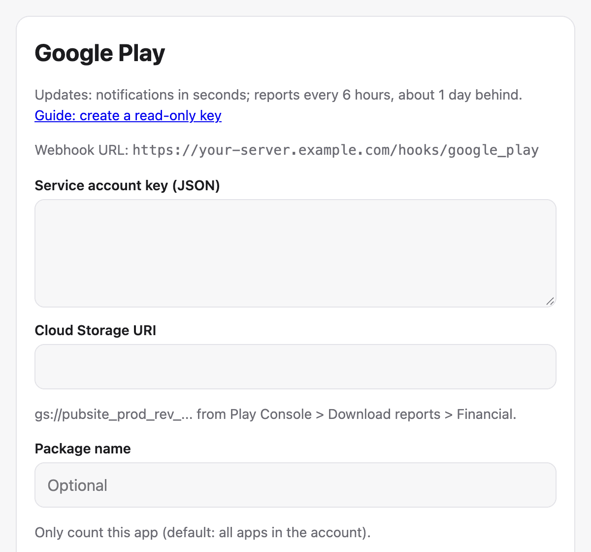

# Google Play

See Google Play sales, units and earnings, with a live feed of purchases and subscriptions. About 15 minutes.

## Create a service account

1. In the [Google Cloud console](https://console.cloud.google.com), open **IAM & Admin**, then **Service Accounts**. Create `tickler-play` with **no** roles.
2. Open it, then **Keys**, **Add key**, **Create new key**, **JSON**.
3. Enable the **Google Play Android Developer API** in the same project.

## Give it access in Play Console

1. In [Play Console](https://play.google.com/console), open **Users and permissions** and click **Invite new users**.
2. Enter the service account's email.
3. Under **Account permissions**, tick only **View financial data, orders, and cancellation survey responses**, and invite.

## Copy the reports bucket URI

In Play Console, open **Download reports**, then **Financial**, and click **Copy Cloud Storage URI**. It looks like `gs://pubsite_prod_rev_01234567890987654321/sales`.

## Paste it into Tickler

In **Money**, open **Google Play**. Paste the whole JSON key file and the Cloud Storage URI. Save and press **Test**: it lists one file in the bucket.

## Send notifications to Tickler

1. In Google Cloud, create a Pub/Sub topic, like `play-rtdn`. Give `google-play-developer-notifications@system.gserviceaccount.com` the **Pub/Sub Publisher** role on it.
2. Create a service account `tickler-push` with no roles.
3. Create a **Push** subscription to `https://<your-server>/hooks/google_play`, with authentication as `tickler-push` and that URL as **Audience**.

## Turn on notifications in Play Console

1. Open your app, then **Monetize**, then **Monetization setup**.
2. Paste the topic name, like `projects/<project>/topics/play-rtdn`, enable notifications, and save.
3. In Tickler, set **Push audience** to the endpoint URL and **Push service account email** to the `tickler-push` email.

## Troubleshooting

- **Notifications need a public URL:** on Docker, set up a tunnel first.
- **Can't create a key:** your organization blocks service account keys (`iam.disableServiceAccountKeyCreation`). An Org Policy Admin must allow them for this project.
- **HTTP 403 on the bucket:** the account permission is missing or not active yet. It can take up to a day.
- **"not valid JSON":** paste the whole key file, braces included.
- **Webhook 401:** the audience or service account email don't match the subscription.
- **Pub/Sub asks about Token Creator:** grant it to the Pub/Sub service agent.
- **Test it:** in **Monetization setup**, press **Send test notification**.
- **About the numbers:** daily sales are before tax and Google's fee, in the buyer's currency. Monthly earnings, after fees, arrive by about the 5th.
- **One app only:** fill in **Package name**.
