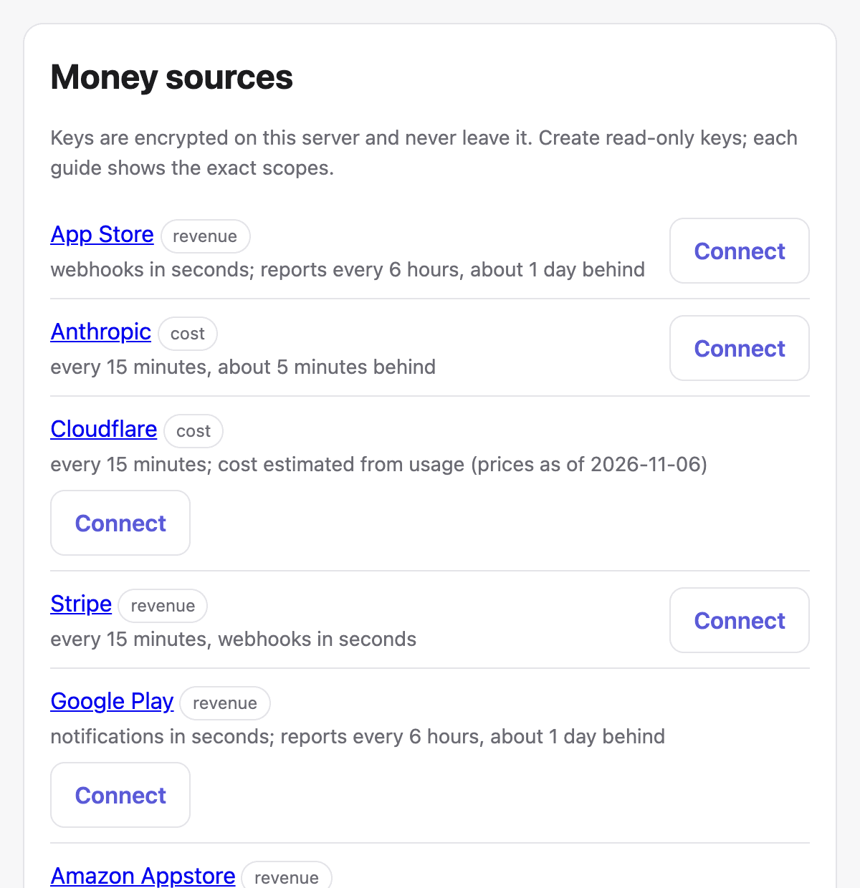
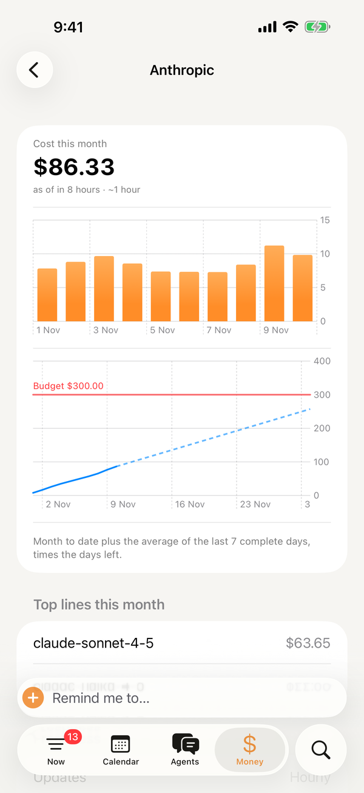

# Money providers

Connect the services that earn or cost you money, each with a read-only key that stays encrypted on your server. About 5 minutes per provider.

## Pick a provider

Open the guide for the service you want. Store webhooks arrive in seconds; everything else is pulled on a schedule, with the provider's own delay.

| Provider | Shows | Updates | Guide |
| --- | --- | --- | --- |
| App Store | Proceeds, units, subs, trials, refunds | Seconds (webhook), reports about 1 day | [App Store](app_store.md) |
| Google Play | Sales, units, subs, refunds, earnings | Seconds (webhook), reports about 1 day | [Google Play](google_play.md) |
| Amazon Appstore | Sales, earnings, subs | Seconds (webhook), reports 1 to 2 days | [Amazon Appstore](amazon_appstore.md) |
| Stripe | Revenue, net, refunds, MRR | Seconds (webhook), 15 min | [Stripe](stripe.md) |
| Anthropic | Spend and tokens by model | 15 min | [Anthropic](anthropic.md) |
| Cloudflare | Workers, D1, R2, KV usage and estimated cost | 15 min | [Cloudflare](cloudflare.md) |
| OpenAI | Spend and tokens | 1 h | [OpenAI](openai.md) |
| GitHub | Actions, Copilot, storage, seats | 1 h, about 1 day behind | [GitHub](github.md) |
| AWS | Cost by service, forecast | About 1 day | [AWS](aws.md) |
| Google Cloud | Cost by service, budgets | Hours to 1 day | [Google Cloud](google_cloud.md) |
| Manual | Anything, fixed costs | When you send it | [Manual](manual.md) |



## Create a read-only key

Follow that provider's guide to create a key with the smallest permissions that work.

## Paste it and test

Paste the key in the app under **Money**, or on your server's setup page under **Money**, and press **Test**.



## Troubleshooting

- **Webhooks need a public URL:** stores send them to `https://<your-server>/hooks/<store>`. On Docker, set up a tunnel first.
- **Revenue:** what you're paid where the source reports it, otherwise sales. Google Play daily sales are before Google's fee.
- **Costs:** the provider's own numbers. Cloudflare is an estimate from usage and a dated price table.
- **Currency:** totals are in your base currency (`TICKLER_CURRENCY`, default USD). Others are shown separately.
- **Forecast:** the provider's own when it has one, otherwise month to date plus the last 7 complete days' average times the days left (UTC).
- **Key files from a computer:** an App Store `.p8` or a Google JSON is easier to add from a `tickler-server` checkout. The command tests the key first, encrypts it with your `TICKLER_SECRET`, and writes it to your D1 database (`--d1 <name>`) or, with `--db /path/to/tickler.sqlite`, to a Docker server. `npm run provider -- test <source> creds.json` only tests.

```sh
cat > creds.json <<'JSON'
{ "issuer_id": "…", "key_id": "…", "private_key": "@AuthKey_ABC123.p8", "vendor_number": "…" }
JSON
TICKLER_SECRET=<your server secret> npm run provider -- set app_store creds.json
rm creds.json
```
