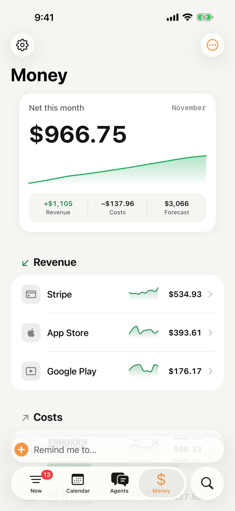
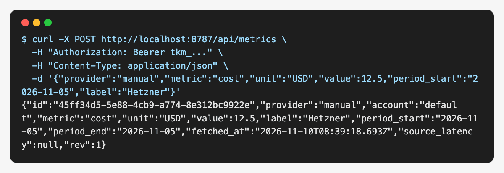
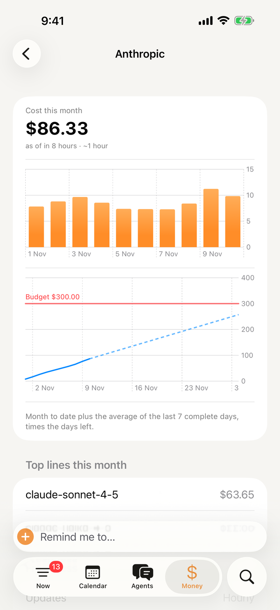

# Manual numbers and fixed costs

Track costs Tickler has no connection for, like hosting bills or domains, by typing them in or sending them from a script. About 2 minutes.

## Add a fixed cost

In the app, open **Money**, then **Fixed costs**. Enter the amount, currency, monthly or yearly, and the next renewal date. Tickler adds an Important entry 14 days before each renewal.



## Push a number from a script

Send a value with an MCP token (`tkm_...`) from setup under **AI tools**. Sending the same value again replaces it.

```sh
curl -X POST https://<your-server>/api/metrics \
  -H "Authorization: Bearer tkm_..." \
  -H "Content-Type: application/json" \
  -d '{"provider":"manual","metric":"cost","unit":"USD","value":12.5,"period_start":"2026-11-05","label":"Hetzner"}'
```



## See it in Money

Open the **Money** tab, then **Manual**. Your value appears under its label, and counts in this month's totals.



## Troubleshooting

- **Fields you can send:**

| Field | Required | Meaning |
| --- | --- | --- |
| `provider` | yes | always `manual` |
| `metric` | yes | `cost`, `revenue`, `proceeds`, `units`, `usage` or `forecast` |
| `unit` | yes | currency code (`USD`) or a unit (`requests`, `users`) |
| `value` | yes | a number in major units (`12.50`) |
| `period_start` | yes | `YYYY-MM-DD` |
| `period_end` | no | defaults to `period_start` (a daily value) |
| `account` | no | defaults to `default` |
| `label` | no | a breakdown line; leave empty for a day's total |

- **Totals look wrong:** send one value per day with no label. Labeled values only appear as breakdown lines.
- **When fixed costs count:** monthly ones every month, yearly ones in their renewal month.
- **Other currencies:** shown with a note and left out of totals.
