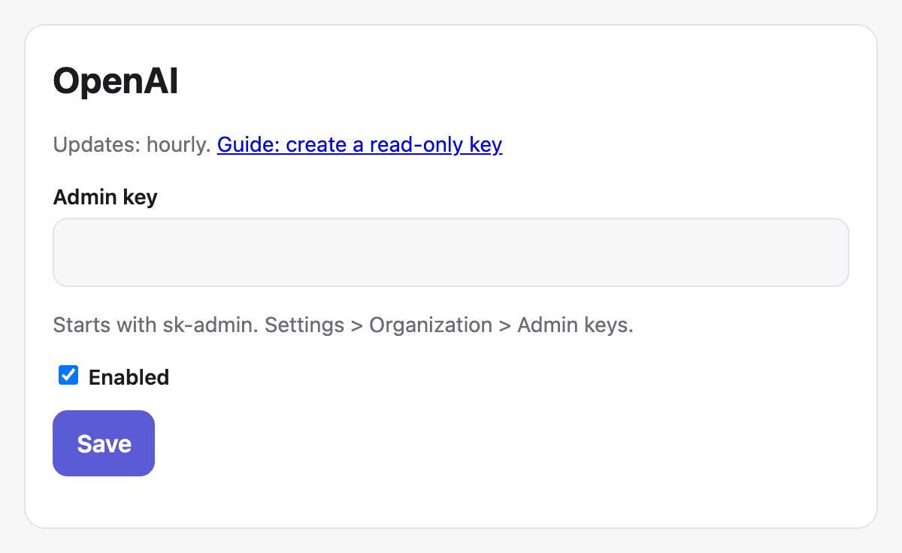
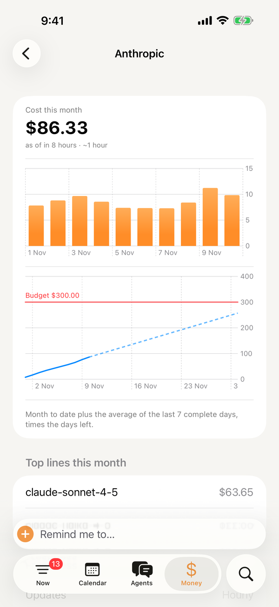

# OpenAI

See your OpenAI API spend and tokens per model, from the organization Costs and Usage APIs. About 3 minutes, as an organization owner.

## Create an admin key

1. In [platform.openai.com](https://platform.openai.com), open **Settings**, then **Organization**, then **Admin keys**.
2. Click **Create new admin key** and name it `Tickler`. If it offers permissions, choose **Read only**.
3. Copy the key (`sk-admin-...`). It's shown once.

## Paste it into Tickler

In **Money**, open **OpenAI**, paste the key, save, and press **Test**. It reads one day of costs.

## Check the numbers

Open the **Money** tab, then **OpenAI**. Your spend appears after the first sync, with the time it was fetched.

## Troubleshooting

- **HTTP 401 or 403:** you pasted a project or user key instead of an admin key, or it was revoked.
- **Costs look low today:** today is still filling in. The forecast uses complete days only.
- **Full admin key:** treat it like a password. Tickler keeps it encrypted on your server and only reads costs and usage.
