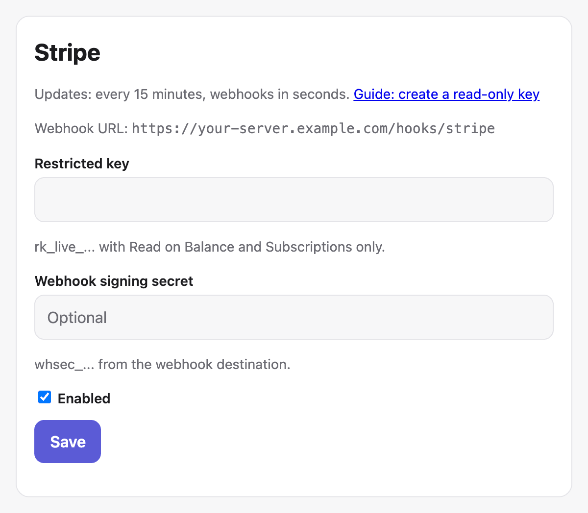

# Stripe

See Stripe revenue, refunds and MRR, plus a live feed of subscriptions, using a read-only key. About 5 minutes.

## Create a restricted key

1. In the Stripe Dashboard, open **Developers**, then **API keys**, and click **Create restricted key**. Name it `Tickler`.
2. Set **Balance** and **Subscriptions** to **Read**. Leave everything else on **None**.
3. Click **Create key** and copy the `rk_live_...` key. It's shown once.

## Paste it into Tickler

In **Money**, open **Stripe**, paste the key into **Restricted key**, save, and press **Test**. It reads your balance and says live or test mode.



## Add the webhook

1. In Stripe, open **Developers**, then **Webhooks**, and click **Create an event destination**.
2. Choose **Your account**, payload style **Snapshot**, and these events.
3. Choose **Webhook endpoint** with URL `https://<your-server>/hooks/stripe`.

```
customer.subscription.created
customer.subscription.updated
customer.subscription.deleted
invoice.paid
invoice.payment_failed
charge.refunded
checkout.session.completed
```

## Paste the signing secret

On the new destination, click **Reveal** next to the signing secret. Paste the `whsec_...` value into **Webhook signing secret** in Tickler and save.

## Troubleshooting

- **Webhook needs a public URL:** on Docker, set up a tunnel first.
- **Don't use your secret key (`sk_live_...`):** it has full access. Tickler warns if you do.
- **Labels look different:** Stripe names the permissions `balance_read` and `subscription_read`.
- **HTTP 401 Invalid API Key:** the key was rolled or deleted.
- **HTTP 403 with a permission name:** set that resource to Read on the restricted key.
- **Webhook 401:** the signing secret is wrong (test and live differ), or the server clock is more than 5 minutes off.
- **Other currencies:** shown separately and left out of totals.
- **MRR:** uses list prices of active subscriptions. Coupons aren't subtracted; metered prices are left out.
- **One-off charges outside Checkout:** count in revenue, but not in the live feed.
